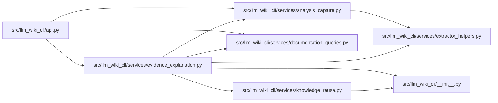

# evidence_explanation Module

**Path:** `src/llm_wiki_cli/services/evidence_explanation.py`

## Description

Adapts the existing evidence explanation service to exact CLI queries without
creating another extractor or changing stored evidence. Exact identities retain
the service result; an exact source with multiple concepts returns bounded
choices and no arbitrarily selected explanation. Snapshot reads never imply
fresh normalization, while live queries require explicit full inventory consent.

Provenance keeps captured source basis, live source basis, stored/live producers,
observed package fingerprint, helper receipt and active runtime distinct. Unknown
stored structural evidence can still disclose a captured manifest basis. Installed
fingerprints do not recover the original wheel/archive identity. Helper inspection
does not install dependencies, repair evidence or confer release authenticity.

## Imports

| Source | Symbols |
|--------|---------|
| `.` | `analysis_capture`, `extractor_helpers`, `knowledge_reuse` |
| `..` | `__version__` |
| `.documentation_queries` | `DocumentationGraphQueryService` |
| `__future__` | `annotations` |
| `dataclasses` | `asdict` |
| `pathlib` | `Path` |
| `platform` | `platform` |
| `sys` | `sys` |
| `typing` | `Any` |

## Local dependency map

<!-- Auto-generated local dependency summary. Do not edit by hand. -->

### Internal neighbors

| Direction | Module |
|---|---|
| Inbound | [api](../modules/api.md) |
| Outbound | [llm_wiki_cli___init__](../modules/llm_wiki_cli___init__.md) |
| Outbound | [analysis_capture](../modules/analysis_capture.md) |
| Outbound | [documentation_queries](../modules/documentation_queries.md) |
| Outbound | [extractor_helpers](../modules/extractor_helpers.md) |
| Outbound | [knowledge_reuse](../modules/knowledge_reuse.md) |

## Functions

| Function | Signature | Decorators | Description |
|----------|-----------|------------|-------------|
| `explain_source` | `(service: DocumentationGraphQueryService, source: str) -> dict[str, Any]` | — | Select only when an exact source has one concept, otherwise offer choices. |
| `explanation_provenance` | `(service: DocumentationGraphQueryService, payload: dict[str, Any], *, source_root: Path, helper_cache_dir: str \| Path \| None) -> dict[str, Any]` | — | Keep observed installation, stored/live producers and runtime distinct. |