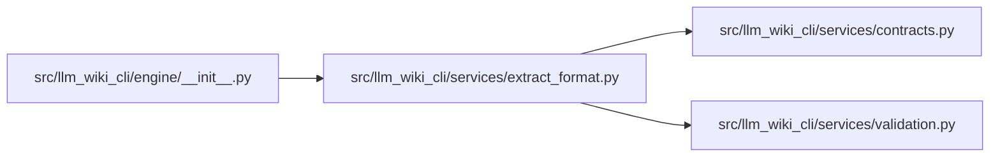

# extract_format Module

**Path:** `src/llm_wiki_cli/services/extract_format.py`

## Description

Format checks for the ``llm-wiki-extract/v1`` source inventory payload.

``extract`` prints a per-file source inventory plus, under ``--deep``, entry
points, data flows, dependency and API-contract analysis. The format is
additive: consumers must tolerate fields they do not know, so file records
and analysis blocks stay open and only the fields every consumer relies on
are checked. The versioned ``data_flow_details`` sibling is strict.

These checks read no source files: they confirm a decoded payload is
internally consistent. A summary payload (``extract --summary``) lists symbol
names as strings; a full payload lists symbol records.

## Imports

| Source | Symbols |
|--------|---------|
| `.contracts` | `EXTRACT_DATA_FLOW_DETAILS_SCHEMA_VERSION`, `EXTRACT_SCHEMA_VERSION` |
| `.validation` | `SharedValidationError`, `require_portable_relative_path` |
| `__future__` | `annotations` |
| `collections.abc` | `Callable`, `Mapping`, `Sequence` |
| `typing` | `Any` |

## Local dependency map

<!-- Auto-generated local dependency summary. Do not edit by hand. -->

### Internal neighbors

| Direction | Module |
|---|---|
| Inbound | [engine___init__](../modules/engine___init__.md) |
| Outbound | [services_contracts](../modules/services_contracts.md) |
| Outbound | [validation](../modules/validation.md) |

## Classes

| Class | Line | Bases | Description |
|-------|------|-------|-------------|
| [ExtractPayloadError](../entities/ExtractPayloadError.md) | 102 | `ValueError` | An extract payload does not follow its format. |

## Functions

| Function | Signature | Decorators | Description |
|----------|-----------|------------|-------------|
| `_text` | `(value: object) -> bool` | — | — |
| `_string` | `(value: object) -> bool` | — | — |
| `_string_or_null` | `(value: object) -> bool` | — | — |
| `_array` | `(value: object) -> bool` | — | — |
| `_object` | `(value: object) -> bool` | — | — |
| `_count` | `(value: object) -> bool` | — | — |
| `_positive` | `(value: object) -> bool` | — | — |
| `validate_extract_payload` | `(document: object) -> None` | — | Raise ``ExtractPayloadError`` unless *document* is a valid extract payload. |
| `_check_inventory` | `(inventory: Mapping[str, Any]) -> None` | — | — |
| `_check_unsupported` | `(value: object) -> frozenset[str]` | — | — |
| `_check_entrypoints` | `(value: object, *, deep: bool) -> list[str]` | — | — |
| `_check_data_flow_details` | `(value: object, *, deep: bool, flows: Sequence[Any] \| None, empty_inventory: bool, unsupported: frozenset[str]) -> None` | — | — |
| `_check_limitations` | `(limitations: Sequence[Any], unsupported: frozenset[str]) -> None` | — | — |
| `_fields` | `(value: object, field: str, required: Mapping[str, _Check], optional: Mapping[str, _Check] \| None = None, *, closed: bool = False) -> Mapping[str, Any]` | — | — |
| `_ids` | `(records: Sequence[Any], field: str) -> list[str]` | — | — |
| `_portable` | `(value: object, field: str) -> None` | — | — |
| `_canonical_portable_path` | `(value: object) -> str \| None` | — | — |
| `_mapping` | `(value: object, field: str) -> Mapping[str, Any]` | — | — |
| `_sequence` | `(value: object, field: str) -> Sequence[Any]` | — | — |
