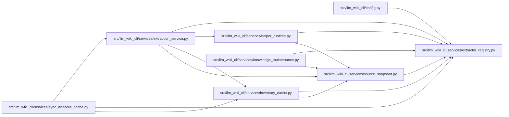

# extractor_registry Module

**Path:** `src/llm_wiki_cli/services/extractor_registry.py`

## Description

Code-documentation source tables: built-in extractors by language and
container build file patterns.

``llm_wiki_cli.config`` re-exports every name for existing callers.

## Imports

| Source | Symbols |
|--------|---------|
| `__future__` | `annotations` |

## Local dependency map

<!-- Auto-generated local dependency summary. Do not edit by hand. -->

### Internal neighbors

| Direction | Module |
|---|---|
| Inbound | [config](../modules/config.md) |
| Inbound | [extraction_service](../modules/extraction_service.md) |
| Inbound | [helper_runtime](../modules/helper_runtime.md) |
| Inbound | [inventory_cache](../modules/inventory_cache.md) |
| Inbound | [knowledge_maintenance](../modules/knowledge_maintenance.md) |
| Inbound | [source_snapshot](../modules/source_snapshot.md) |
| Inbound | [sync_analysis_cache](../modules/sync_analysis_cache.md) |
