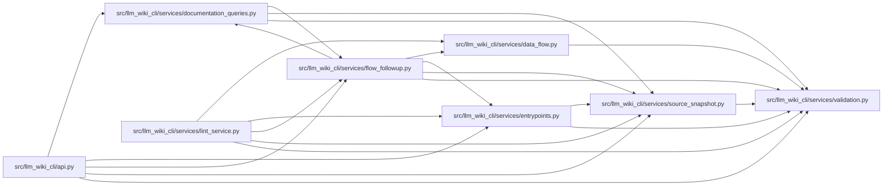

# flow_followup Module

**Path:** `src/llm_wiki_cli/services/flow_followup.py`

## Description

Bounded, source-bound navigation over an already captured static call graph.

Offsets page one deterministic trace; a depth frontier narrows to a new exact
root in the same graph. Neither operation executes source or extends a legacy
flow's analysis limits. Querying again repeats graph counting, not extraction.

## Imports

| Source | Symbols |
|--------|---------|
| `.data_flow` | `_STEP_LIMIT` |
| `.documentation_queries` | `DocumentationQueryError` |
| `.entrypoints` | `DEFAULT_FLOW_DEPTH`, `_build_adjacency`, `_flow_step_from_edge`, `_iter_callables` |
| `.source_snapshot` | `SourceSnapshot` |
| `.validation` | `require_portable_relative_path` |
| `__future__` | `annotations` |
| `collections.abc` | `Iterator`, `Mapping` |
| `hashlib` | `hashlib` |
| `json` | `json` |
| `re` | `re` |
| `typing` | `Any` |

## Local dependency map

<!-- Auto-generated local dependency summary. Do not edit by hand. -->

### Internal neighbors

| Direction | Module |
|---|---|
| Inbound | [api](../modules/api.md) |
| Inbound | [documentation_queries](../modules/documentation_queries.md) |
| Inbound | [lint_service](../modules/lint_service.md) |
| Outbound | [data_flow](../modules/data_flow.md) |
| Outbound | [documentation_queries](../modules/documentation_queries.md) |
| Outbound | [entrypoints](../modules/entrypoints.md) |
| Outbound | [source_snapshot](../modules/source_snapshot.md) |
| Outbound | [validation](../modules/validation.md) |

## Functions

| Function | Signature | Decorators | Description |
|----------|-----------|------------|-------------|
| `_portable_file` | `(value: str) -> str` | — | Keep the shared path adapter separate from flow request semantics. |
| `validate_request` | `(value: object, basis: object = None, offset: object = 0) -> tuple[str, str]` | — | Validate before any workspace access, including exact portable identity. |
| `_binding` | `(inventory: dict, edges: list[dict], receipt: object, query_binding: Mapping \| None, limit: int) -> tuple[str \| None, int, int]` | — | — |
| `_walk` | `(start: tuple, adjacency: dict, depth_limit: int \| None, work: dict) -> Iterator[tuple[dict, int]]` | — | Visit each internal node once, keeping only the active iterator stack. |
| `_request` | `(value: str, basis: str, *, offset: int = 0, limit: int = _STEP_LIMIT) -> dict` | — | — |
| `_unavailable` | `(reason: str) -> dict` | — | — |
| `segment` | `(inventory: dict, edges: list[dict], receipt: object, value: str, *, limit: int, basis: str \| None = None, offset: int = 0, query_binding: Mapping \| None = None) -> dict[str, Any]` | — | — |
