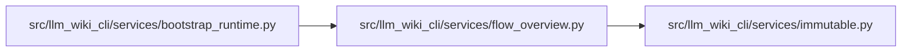

# flow_overview Module

**Path:** `src/llm_wiki_cli/services/flow_overview.py`

## Description

Pure bounded presentation selection over a complete captured call trace.

## Imports

| Source | Symbols |
|--------|---------|
| `.immutable` | `freeze` |
| `__future__` | `annotations` |
| `collections` | `defaultdict` |
| `collections.abc` | `Mapping`, `Sequence` |
| `dataclasses` | `dataclass` |
| `typing` | `Any` |

## Local dependency map

<!-- Auto-generated local dependency summary. Do not edit by hand. -->

### Internal neighbors

| Direction | Module |
|---|---|
| Inbound | [bootstrap_runtime](../modules/bootstrap_runtime.md) |
| Outbound | [immutable](../modules/immutable.md) |

## Classes

| Class | Line | Bases | Description |
|-------|------|-------|-------------|
| [FlowOverview](../entities/FlowOverview.md) | 21 | — | Original occurrence evidence and its separate presentation selection. |

## Functions

| Function | Signature | Decorators | Description |
|----------|-----------|------------|-------------|
| `_coordinate` | `(step: Mapping[str, Any]) -> dict[str, Any]` | — | — |
| `select_flow_overview` | `(flow: Mapping[str, Any], interactions: Sequence[Mapping[str, Any]], *, limit: int = 30) -> FlowOverview` | — | Balance depth and actual-parent siblings without rewriting call evidence. |
| `trim_flow_overview` | `(overview: FlowOverview, displayed_count: int) -> FlowOverview` | — | Reconcile the actual renderer-admitted prefix against the complete trace. |
