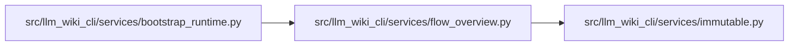

# flow_overview Module

**Path:** `src/llm_wiki_cli/services/flow_overview.py`

## Description

Pure bounded presentation selection over a complete captured call trace.

When the captured trace exceeds the display budget, immediate internal siblings
and internal occurrences with coherent captured children take priority. Distinct
exact internal targets receive representative occurrences before repeated helper
sites, alongside examples of captured external and unresolved boundaries. All
original occurrences, arguments and caller/target metadata remain available for
coverage and omission accounting; no aggregate invocation or replacement parent
is inferred. Smaller and boundary-only traces retain their existing ordering.

The diagram renderer can admit a shorter prefix under its node, line or character
ceilings. Final counts reflect that admitted prefix separately from the upstream
depth-bound trace. Display order, a resolved declaration body and a generator
call do not establish runtime execution or consumption.

## Imports

| Source | Symbols |
|--------|---------|
| `.immutable` | `freeze` |
| `__future__` | `annotations` |
| `collections` | `defaultdict` |
| `collections.abc` | `Mapping`, `Sequence` |
| `dataclasses` | `dataclass` |
| `typing` | `Any` |

## Local dependency map

<!-- Auto-generated local dependency summary. Do not edit by hand. -->

### Internal neighbors

| Direction | Module |
|---|---|
| Inbound | [bootstrap_runtime](../modules/bootstrap_runtime.md) |
| Outbound | [immutable](../modules/immutable.md) |

## Classes

| Class | Line | Bases | Description |
|-------|------|-------|-------------|
| [FlowOverview](../entities/FlowOverview.md) | 21 | — | Original occurrence evidence and its separate presentation selection. |

## Functions

| Function | Signature | Decorators | Description |
|----------|-----------|------------|-------------|
| `_coordinate` | `(step: Mapping[str, Any]) -> dict[str, Any]` | — | — |
| `select_flow_overview` | `(flow: Mapping[str, Any], interactions: Sequence[Mapping[str, Any]], *, limit: int = 30) -> FlowOverview` | — | Select representative internal continuations and captured boundaries. |
| `trim_flow_overview` | `(overview: FlowOverview, displayed_count: int) -> FlowOverview` | — | Reconcile the actual renderer-admitted prefix against the complete trace. |
