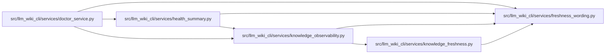

# freshness_wording Module

**Path:** `src/llm_wiki_cli/services/freshness_wording.py`

## Description

Shared interpretation of the legacy structural freshness diagnostic.

## Local dependency map

<!-- Auto-generated local dependency summary. Do not edit by hand. -->

### Internal neighbors

| Direction | Module |
|---|---|
| Inbound | [doctor_service](../modules/doctor_service.md) |
| Inbound | [health_summary](../modules/health_summary.md) |
| Inbound | [knowledge_freshness](../modules/knowledge_freshness.md) |
| Inbound | [knowledge_observability](../modules/knowledge_observability.md) |
