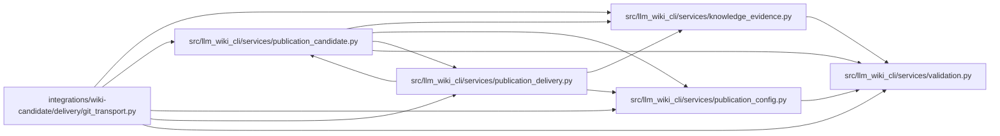

# git_transport Module

**Path:** `integrations/wiki-candidate/delivery/git_transport.py`

## Description

Fast-forward delivery to an initialized sibling wiki, verified through Git readback.

## Imports

| Source | Symbols |
|--------|---------|
| `__future__` | `annotations` |
| `base64` | `base64` |
| `contextlib` | `contextmanager` |
| `dataclasses` | `dataclass`, `field` |
| `llm_wiki_cli.services.knowledge_evidence` | `hash_json`, `sha256_bytes` |
| `llm_wiki_cli.services.publication_candidate` | `MAX_FILE_BYTES`, `MAX_FILES`, `MAX_TREE_BYTES` |
| `llm_wiki_cli.services.publication_config` | `publication_repository`, `validate_publication_config` |
| `llm_wiki_cli.services.publication_delivery` | `CHECKPOINT_PATH`, `plan_delivery`, `plan_rollback`, `split_delivery_tree` |
| `llm_wiki_cli.services.validation` | `require_portable_relative_path` |
| `os` | `os` |
| `pathlib` | `Path` |
| `re` | `re` |
| `subprocess` | `subprocess` |
| `tempfile` | `TemporaryDirectory` |

## Local dependency map

<!-- Auto-generated local dependency summary. Do not edit by hand. -->

### Internal neighbors

| Direction | Module |
|---|---|
| Outbound | [knowledge_evidence](../modules/knowledge_evidence.md) |
| Outbound | [publication_candidate](../modules/publication_candidate.md) |
| Outbound | [publication_config](../modules/publication_config.md) |
| Outbound | [publication_delivery](../modules/publication_delivery.md) |
| Outbound | [validation](../modules/validation.md) |

## Classes

| Class | Line | Bases | Description |
|-------|------|-------|-------------|
| [DeliveryError](../entities/DeliveryError.md) | 46 | `ValueError` | Delivery could not be verified; no local success checkpoint is available. |
| [_Remote](../entities/Remote.md) | 57 | — | — |
| [_Session](../entities/Session.md) | 353 | — | — |

## Functions

| Function | Signature | Decorators | Description |
|----------|-----------|------------|-------------|
| `_oid` | `(value)` | — | — |
| `_remote` | `(value, repository, *, wiki, token)` | — | — |
| `_git` | `(directory, *arguments, remote = None, raw = None, extra_env = None, check = True)` | — | — |
| `_text` | `(directory, *args)` | — | — |
| `_resolve` | `(directory, remote, requested = None)` | — | — |
| `_fetch` | `(repo, remote, ref, expected, *, ancestry_only = False)` | — | — |
| `_new_repo` | `(root, name, oid)` | — | — |
| `_read` | `(repo, revision)` | — | — |
| `_last_checkpoint_commit` | `(repo, revision)` | — | — |
| `_checkpoint` | `(repo, revision, files)` | — | Relate the observed marker to the commit and prior state it claims. |
| `_tree` | `(repo, parent, before, entries, desired, restore_modes)` | — | — |
| `_session` | `(*, policy, source_repository, target_repository, source_remote, target_remote, source_revision, source_ref = None, source_token = None, target_token = None)` | `@contextmanager` | — |
| `_push` | `(session, commit)` | — | — |
| `_publish` | `(session, before, entries, desired, checkpoint, *, action, restore_modes = None, replay = False)` | — | — |
| `deliver` | `(*, receipt, files, policy, source_repository, target_repository, source_remote, target_remote, source_ref = None, source_token = None, target_token = None)` | — | Publish one already checked and accepted artifact, with a fresh remote proof. |
| `_verify_replay` | `(session, base)` | — | — |
| `qualify` | `(*, policy, source_repository, target_repository, source_remote, target_remote, source_revision, source_ref = None, source_token = None, target_token = None)` | — | Probe reachability of receive-pack without modifying the wiki or treating that as a write proof. |
| `_roll` | `(*, policy, source_repository, target_repository, source_remote, target_remote, source_revision, target_revision, restore_revision, accepted_rollback_id, source_ref = None, source_token = None, target_token = None)` | — | — |
| `preview_rollback` | `(**options)` | — | Read the exact proposed restoration and its review ID without writing. |
| `rollback` | `(*, accepted_rollback_id, **options)` | — | Publish a new forward commit restoring only the reviewed owned outputs. |
