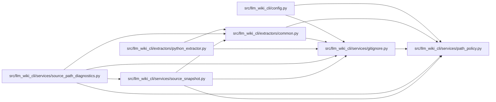

# gitignore Module

**Path:** `src/llm_wiki_cli/services/gitignore.py`

## Description

Gitignore matching for source discovery.

``llm_wiki_cli.config`` re-exports every name for existing callers.

## Imports

| Source | Symbols |
|--------|---------|
| `.path_policy` | `EXCLUDED_DIRS`, `is_agent_worktree_path` |
| `__future__` | `annotations` |
| `dataclasses` | `dataclass` |
| `fnmatch` | `fnmatch` |
| `pathlib` | `Path` |

## Local dependency map

<!-- Auto-generated local dependency summary. Do not edit by hand. -->

### Internal neighbors

| Direction | Module |
|---|---|
| Inbound | [config](../modules/config.md) |
| Inbound | [common](../modules/common.md) |
| Inbound | [python_extractor](../modules/python_extractor.md) |
| Inbound | [source_path_diagnostics](../modules/source_path_diagnostics.md) |
| Inbound | [source_snapshot](../modules/source_snapshot.md) |
| Outbound | [path_policy](../modules/path_policy.md) |

## Classes

| Class | Line | Bases | Description |
|-------|------|-------|-------------|
| [_GitignoreRule](../entities/GitignoreRule.md) | 16 | — | — |
| [GitIgnoreMatcher](../entities/GitIgnoreMatcher.md) | 23 | — | Ordered gitignore matcher for repository scans. |

## Functions

| Function | Signature | Decorators | Description |
|----------|-----------|------------|-------------|
| `_normalize_gitignore_trailing_spaces` | `(line: str) -> str` | — | Remove Git-insignificant trailing spaces from one ignore pattern. |
| `_parse_gitignore_text` | `(raw_text: str, base: str = '') -> list[_GitignoreRule]` | — | Parse already captured gitignore text without performing file I/O. |
| `_parse_gitignore_file` | `(gitignore_path: Path, base: str = '') -> list[_GitignoreRule]` | — | — |
| `_match_gitignore_pattern` | `(rel_path: str, pattern: str, *, directory_only: bool = False) -> bool` | — | Check if a relative path matches a gitignore pattern. |
| `_rule_matches` | `(rel_path: str, rule: _GitignoreRule) -> bool` | — | — |
| `build_gitignore_matcher` | `(root: 'str \| Path') -> GitIgnoreMatcher` | — | Parse root and nested .gitignore files once for a source scan. |
| `is_ignored_by_gitignore` | `(rel_path: str, gitignore_path: Path = Path('.gitignore')) -> bool` | — | Check if a relative path is ignored according to one .gitignore file. |
