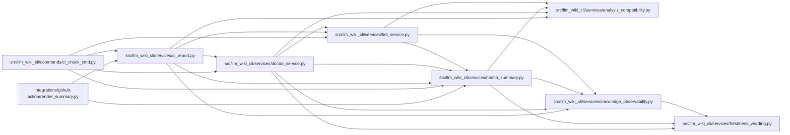

# health_summary Module

**Path:** `src/llm_wiki_cli/services/health_summary.py`

## Description

Pure presentation helpers for detailed local and CI health reports.

Summaries distinguish blocking structural integrity, advisory drift, health
classification, separately bound release policy and optional assurance.
Diagnostic previews prioritize actionable causes while retaining exact totals
and routes to complete rows. Captured detail can refine a legacy reason without
changing its stored code or promoting unavailable comparisons to current.

## Imports

| Source | Symbols |
|--------|---------|
| `.` | `analysis_compatibility` |
| `.freshness_wording` | `SOURCE_CHANGED_STRUCTURE_UNCHANGED` |
| `.knowledge_observability` | `knowledge_freshness_hint` |
| `__future__` | `annotations` |
| `collections` | `defaultdict` |
| `collections.abc` | `Mapping`, `Sequence` |
| `hashlib` | `hashlib` |
| `json` | `json` |
| `re` | `re` |
| `typing` | `Any` |
| `unicodedata` | `unicodedata` |

## Local dependency map

<!-- Auto-generated local dependency summary. Do not edit by hand. -->

### Internal neighbors

| Direction | Module |
|---|---|
| Inbound | [render_summary](../modules/render_summary.md) |
| Inbound | [ci_check_cmd](../modules/ci_check_cmd.md) |
| Inbound | [ci_report](../modules/ci_report.md) |
| Inbound | [doctor_service](../modules/doctor_service.md) |
| Inbound | [lint_service](../modules/lint_service.md) |
| Outbound | [analysis_compatibility](../modules/analysis_compatibility.md) |
| Outbound | [freshness_wording](../modules/freshness_wording.md) |
| Outbound | [knowledge_observability](../modules/knowledge_observability.md) |

## Functions

| Function | Signature | Decorators | Description |
|----------|-----------|------------|-------------|
| `summary_cell` | `(value: object, limit: int = 240) -> str` | — | Escape inline-code/table content and explicitly disclose UTF-8 clipping. |
| `health_policy` | `(strict: bool) -> str` | — | Describe classification independently of an Action's failure threshold. |
| `optional_status` | `(state: str, *, absent: str) -> str` | — | Disclose optional absence without changing present evidence states. |
| `assurance_rows` | `(report: Mapping) -> list[tuple[str, str]]` | — | Describe captured assurance without inferring adoption or review coverage. |
| `ci_health_rows` | `(report: Mapping, health: Mapping) -> list[tuple[str, str]]` | — | Reuse the captured classification without inferring release admission. |
| `_diagnostic_kind` | `(record: Mapping) -> str` | — | — |
| `_diagnostic_priority` | `(category: str, kind: str) -> int` | — | — |
| `_record_order` | `(record: Mapping) -> tuple[str, ...]` | — | — |
| `diagnostic_groups` | `(records: Sequence[Mapping]) -> list[dict[str, Any]]` | — | Partition emitted records; external grouping needs an exact producer prefix. |
| `diagnostic_preview` | `(records: Sequence[Mapping]) -> dict[str, Any]` | — | Bound examples, keeping duplicate occurrences and exact omitted totals. |
| `_diagnostic_anchor` | `(group: Mapping) -> str` | — | — |
| `_display_hint` | `(record: Mapping, health: Mapping \| None) -> str \| None` | — | — |
| `_legacy_scope_disclosure` | `(record: Mapping) -> str \| None` | — | — |
| `render_validation_markdown` | `(report: Mapping, *, health: Mapping \| None = None) -> str` | — | Present a bounded prefix and complete deterministic rows; never scan source. |
| `freshness_counts` | `(counts: Mapping[str, int] \| None) -> str` | — | Describe existing state counters without inventing model eligibility. |
| `reason_list` | `(reasons: Sequence[str], limit: int = 5) -> str` | — | List a bounded prefix of reported reasons, without estimating counts. |
| `_versions` | `(recorded, live, kind: str, limit: int = 3) -> str` | — | — |
| `captured_analysis_diagnostic` | `(report: Mapping) -> dict \| None` | — | Read validated native commitments, never the current installation. |
| `detailed_health_rows` | `(report: Mapping) -> list[tuple[str, str]]` | — | Describe validated evidence; legacy reports cannot gain inferred detail. |
