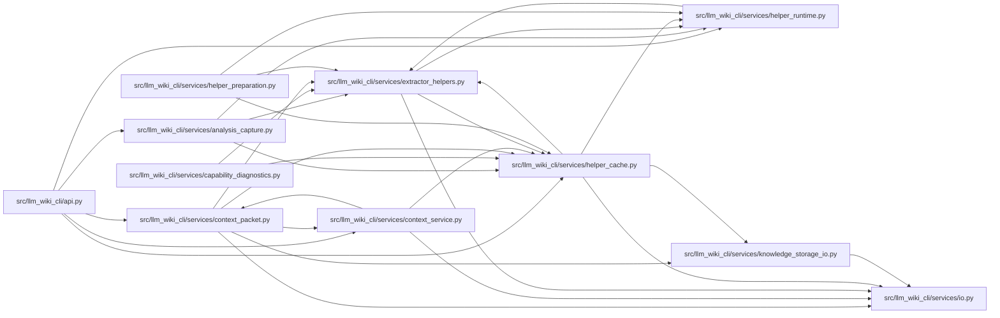

# helper_cache Module

**Path:** `src/llm_wiki_cli/services/helper_cache.py`

## Description

Transactional, project-independent storage for bundled extractor helpers.

Lookups observe existing receipts only. Preparation owns a per-profile lock and
an unpublished staging tree; consumers receive the exact validated artifact,
never a mutable language-wide current pointer.

## Imports

| Source | Symbols |
|--------|---------|
| `.` | `extractor_helpers` |
| `.helper_runtime` | `PreparedHelperHandle`, `current_helper_operation`, `PreparedHelperHandle`, `current_helper_operation` |
| `.io` | `first_unsafe_path_component`, `write_json_atomic` |
| `.knowledge_storage_io` | `read_guarded` |
| `__future__` | `annotations` |
| `ast` | `ast` |
| `contextlib` | `contextmanager` |
| `dataclasses` | `dataclass` |
| `errno` | `errno` |
| `fcntl` | `fcntl` |
| `hashlib` | `hashlib` |
| `json` | `json` |
| `msvcrt` | `msvcrt` |
| `os` | `os` |
| `pathlib` | `Path` |
| `platform` | `platform` |
| `re` | `re` |
| `shutil` | `shutil` |
| `signal` | `signal` |
| `stat` | `stat` |
| `subprocess` | `subprocess` |
| `sys` | `sys` |
| `tempfile` | `tempfile` |
| `time` | `time` |
| `typing` | `Callable`, `TYPE_CHECKING` |
| `uuid` | `uuid` |

## Local dependency map

<!-- Auto-generated local dependency summary. Do not edit by hand. -->

### Internal neighbors

| Direction | Module |
|---|---|
| Inbound | [api](../modules/api.md) |
| Inbound | [analysis_capture](../modules/analysis_capture.md) |
| Inbound | [capability_diagnostics](../modules/capability_diagnostics.md) |
| Inbound | [context_packet](../modules/context_packet.md) |
| Inbound | [context_service](../modules/context_service.md) |
| Inbound | [extractor_helpers](../modules/extractor_helpers.md) |
| Inbound | [helper_preparation](../modules/helper_preparation.md) |
| Outbound | [extractor_helpers](../modules/extractor_helpers.md) |
| Outbound | [helper_runtime](../modules/helper_runtime.md) |
| Outbound | [io](../modules/io.md) |
| Outbound | [knowledge_storage_io](../modules/knowledge_storage_io.md) |

## Classes

| Class | Line | Bases | Description |
|-------|------|-------|-------------|
| [HelperPreparationError](../entities/HelperPreparationError.md) | 47 | `RuntimeError` | The selected bundled helper could not be prepared once. |
| [_Profile](../entities/Profile.md) | 410 | — | — |

## Functions

| Function | Signature | Decorators | Description |
|----------|-----------|------------|-------------|
| `_safe` | `(path: Path) -> Path` | — | — |
| `user_helper_cache_root` | `() -> Path` | — | Resolve the managed helper cache without inspecting or creating it. |
| `cache_roots` | `(src_dir: str \| Path = '.', cache_dir: str \| None = None) -> tuple[Path, ...]` | — | Keep explicit/environment scope authoritative; otherwise reuse legacy data. |
| `preparation_cache_root` | `(src_dir: str \| Path = '.', cache_dir: str \| None = None) -> Path` | — | — |
| `_json` | `(path: Path) -> dict` | — | — |
| `_machine` | `() -> str` | — | — |
| `_system` | `() -> str` | — | — |
| `_native_binary` | `(path: Path) -> None` | — | Reject foreign-target outputs without executing a newly built binary. |
| `_runtime_paths` | `(language: str) -> dict[str, str]` | — | — |
| `_native_fingerprint` | `(path: Path) -> str` | — | — |
| `_handle` | `(cache_root: Path, language: str, key: str, root: Path, path: Path, receipt: dict, runtime_executables = None) -> PreparedHelperHandle` | — | — |
| `_with_runtime` | `(handle: PreparedHelperHandle, executables: dict[str, str]) -> PreparedHelperHandle` | — | — |
| `_manifest_version` | `(language: str) -> int` | — | — |
| `_validate_artifact` | `(language: str, cache_root: Path, root: Path, manifest: dict) -> Path` | — | — |
| `_prepared_with_node` | `(profile: object, identity: dict) -> bool` | — | — |
| `_slot_handle` | `(cache_root: Path, language: str, slot: Path, *, node_identity: dict \| None = None) -> PreparedHelperHandle \| None` | — | — |
| `_legacy_handle` | `(cache_root: Path, language: str) -> PreparedHelperHandle \| None` | — | — |
| `_profile_slots` | `(directory: Path) -> list[Path]` | — | — |
| `_check_profile_capacity` | `(destination: Path) -> None` | — | — |
| `lookup_helper` | `(language: str, src_dir: str \| Path = '.', cache_dir: str \| None = None) -> PreparedHelperHandle \| None` | — | Inspect valid existing project/shared artifacts without writes or builds. |
| `validate_handle` | `(handle: PreparedHelperHandle) -> bool` | — | Re-observe exactly the pinned bytes; never repair, rebind or run tools. |
| `_profile_key` | `(language: str, profile: dict) -> str` | — | — |
| `_executable_identity` | `(executables: dict[str, str]) -> dict` | — | — |
| `_build_environment` | `(cache_root: Path) -> dict[str, str]` | — | — |
| `_output` | `(command: list[str], *, cwd: Path, env: dict[str, str]) -> str` | — | — |
| `_target_matches` | `(target: str) -> bool` | — | — |
| `_selected_rust_executable` | `(name: str, env: dict[str, str], cwd: Path) -> str` | — | — |
| `_profile` | `(language: str, cache_root: Path, cwd: Path) -> _Profile` | — | — |
| `_run` | `(command: list[str], *, cwd: Path, env: dict[str, str], timeout: float) -> str` | — | — |
| `_lock` | `(path: Path, wait_seconds: float)` | `@contextmanager` | — |
| `_sandbox` | `(source_root: Path)` | — | — |
| `_build` | `(language: str, stage: Path, profile: _Profile, cwd: Path) -> dict` | — | — |
| `_artifact_path` | `(language: str, root: Path) -> Path` | — | — |
| `_copy_artifact` | `(language: str, source: Path, destination: Path) -> None` | — | Copy only verified execution inputs to the cache-local publish stage. |
| `ensure_helper` | `(language: str, src_dir: str \| Path = '.', cache_dir: str \| None = None, *, progress: Callable[[str], None] \| None = None, wait_seconds: float = LOCK_WAIT_SECONDS) -> PreparedHelperHandle` | — | Prepare one selected helper once, publishing only fully validated data. |
