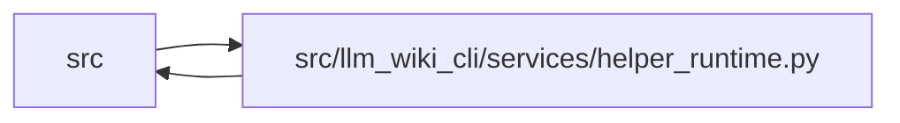

# helper_runtime Module

**Path:** `src/llm_wiki_cli/services/helper_runtime.py`

## Description

Operation-owned helper policy and immutable prepared-artifact bindings.

Configuration scopes carry defaults only. Each top-level analysis opens an
operation; nested implementation calls may share it, but a later top-level
call gets fresh bindings. These primitives never inspect or prepare a helper.

## Imports

| Source | Symbols |
|--------|---------|
| `..config` | `EXTRACTOR_REGISTRY` |
| `.extractor_helpers` | `SUPPORTED_HELPERS` |
| `.immutable` | `freeze` |
| `.source_snapshot` | `SourceSnapshot` |
| `__future__` | `annotations` |
| `collections.abc` | `Callable`, `Iterable`, `Iterator`, `Mapping` |
| `contextlib` | `contextmanager` |
| `contextvars` | `ContextVar` |
| `dataclasses` | `dataclass`, `field` |
| `os` | `os` |
| `pathlib` | `Path` |
| `types` | `MappingProxyType` |
| `typing` | `Literal`, `TYPE_CHECKING`, `cast` |

## Local dependency map

<!-- Auto-generated local dependency summary. Do not edit by hand. -->

> Module-level dependencies exceed the generated-diagram limits, so the diagram and table below group them by top-level package. Counts report the number of module neighbors in each package.

### Internal neighbors

| Direction | Module |
|---|---|
| Inbound | `src` (12) |
| Outbound | `src` (4) |

> All 15 module neighbor(s) are summarized by package because the module-level view exceeds the 12-node limit.

## Classes

| Class | Kind | Line | Bases / Target | Description |
|-------|------|------|----------------|-------------|
| [HelperPolicy](../entities/HelperPolicy.md) | Type alias | 26 | `Literal['auto', 'never']` | — |
| [PreparedHelperHandle](../entities/PreparedHelperHandle.md) | Class | 57 | — | Detached artifact and receipt selected once by the preparation owner. |
| [HelperConfiguration](../entities/HelperConfiguration.md) | Class | 89 | — | — |
| [HelperOperation](../entities/HelperOperation.md) | Class | 96 | — | — |

## Functions

| Function | Signature | Decorators | Description |
|----------|-----------|------------|-------------|
| `resolve_helper_policy` | `(requested: str \| None = None, *, strict_read_only: bool = False, preview: bool = False, offline: bool = False) -> HelperPolicy` | — | Resolve preparation authority without changing workspace mutability. |
| `_absolute` | `(path: str \| Path) -> Path` | — | — |
| `current_helper_configuration` | `() -> HelperConfiguration \| None` | — | — |
| `current_helper_policy` | `() -> HelperConfiguration \| None` | — | Return configured defaults, never an artifact/operation binding. |
| `current_helper_operation` | `() -> HelperOperation \| None` | — | — |
| `_cache_value` | `(cache_dir: str \| Path \| None) -> str \| None` | — | — |
| `_check_progress` | `(progress: HelperProgress \| None) -> None` | — | — |
| `helper_policy` | `(policy: str, *, cache_dir: str \| Path \| None = None, progress: HelperProgress \| None = None) -> Iterator[HelperConfiguration]` | `@contextmanager` | Configure independent calls without retaining their prepared handles. |
| `helper_operation` | `(policy: str \| None = None, *, fresh: bool = False, cache_dir: str \| Path \| None = None, progress: HelperProgress \| None = None) -> Iterator[HelperOperation]` | `@contextmanager` | Own one capture/extraction binding; nested calls inherit compatible state. |
| `bind_helper` | `(handle: PreparedHelperHandle, *, source_root: str \| Path \| None = None) -> None` | — | — |
| `pinned_helper` | `(language: str, cache_root: str \| Path \| None = None, *, source_root: str \| Path \| None = None) -> PreparedHelperHandle \| None` | — | — |
| `operation_cache_root` | `(source_root: str \| Path, language: str \| None = None) -> Path \| None` | — | — |
| `required_helper_languages` | `(snapshot: SourceSnapshot, registry: Mapping[str, str], *, only_files: Iterable[str] \| None = None) -> tuple[str, ...]` | — | Plan only bundled extraction within the already validated source boundary. |
