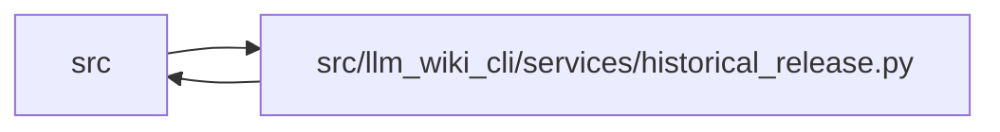

# historical_release Module

**Path:** `src/llm_wiki_cli/services/historical_release.py`

## Description

Release a verified historical binding without updating or adopting any source.

## Imports

| Source | Symbols |
|--------|---------|
| `.infrastructure_sync` | `infrastructure_evidence_by_page` |
| `.knowledge_orchestration` | `capture_committed_knowledge` |
| `.knowledge_reuse` | `REUSE_INPUT_KEY`, `REUSE_EXTENSION_KEY` |
| `.sync_analysis_cache` | `EXTENSION` |
| `dataclasses` | `replace` |
| `hashlib` | `hashlib` |
| `llm_wiki_engine` | `historical_sources` |
| `llm_wiki_engine.contracts` | `SECTION_OWNERSHIP_EXTENSION_KEY` |
| `llm_wiki_engine.io` | `decode_markdown_bytes`, `write_bytes_atomic` |
| `llm_wiki_engine.knowledge_artifacts` | `build_knowledge_commit_plan`, `commit_knowledge_artifacts`, `validated_artifact_bytes` |
| `llm_wiki_engine.knowledge_envelope` | `EvaluatedEnvelope`, `hash_markdown_snapshot` |
| `llm_wiki_engine.knowledge_index` | `KnowledgeIndexInputs`, `_assemble_knowledge_index` |
| `llm_wiki_engine.knowledge_links` | `collect_link_observations` |
| `llm_wiki_engine.knowledge_storage` | `MAX_EXPANDED_BYTES` |
| `llm_wiki_engine.knowledge_storage_io` | `StorageReadSession`, `read_guarded` |
| `llm_wiki_engine.maintenance_protocol` | `guard_maintenance_owner` |
| `llm_wiki_engine.section_ownership` | `observe_page_sections` |
| `llm_wiki_engine.source_retirement` | `SourceRetirementError` |
| `llm_wiki_engine.sync_manifest` | `MANIFEST_FILENAME`, `SyncManifest` |
| `llm_wiki_engine.sync_transition_execution` | `_bounded_page_digest` |
| `llm_wiki_engine.wiki_media` | `build_asset_index` |
| `llm_wiki_engine.wiki_surface` | `PageKind`, `collect_wiki_pages` |
| `pathlib` | `Path` |

## Local dependency map

<!-- Auto-generated local dependency summary. Do not edit by hand. -->

> Module-level dependencies exceed the generated-diagram limits, so the diagram and table below group them by top-level package. Counts report the number of module neighbors in each package.

### Internal neighbors

| Direction | Module |
|---|---|
| Inbound | `src` (1) |
| Outbound | `src` (20) |

> All 21 module neighbor(s) are summarized by package because the module-level view exceeds the 12-node limit.

## Functions

| Function | Signature | Decorators | Description |
|----------|-----------|------------|-------------|
| `_read_originals` | `(root, canonical_pages)` | — | — |
| `_project` | `(artifacts, manifest, root, pages, content, released)` | — | Refresh Markdown-derived index facts only. Keep the evaluated source snapshot. |
| `run_release` | `(options, write_basis)` | — | Plan and publish one manifest-last release. Source changes are deliberately deferred. |
