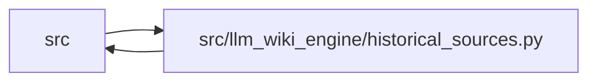

# historical_sources Module

**Path:** `src/llm_wiki_engine/historical_sources.py`

## Description

Native custody of explicitly retained pages from a removed source file.

## Imports

| Source | Symbols |
|--------|---------|
| `.contracts` | `SECTION_OWNERSHIP_EXTENSION_KEY` |
| `.io` | `decode_markdown_bytes` |
| `.knowledge_artifacts` | `require_validated_artifacts`, `require_validated_artifacts` |
| `.knowledge_envelope` | `EvaluatedEnvelope` |
| `.knowledge_evidence` | `hash_json`, `is_valid_sha256`, `sha256_bytes` |
| `.markdown_sections` | `parse_markdown_document` |
| `.source_retirement` | `SourceRetirementError` |
| `.sync_manifest` | `PRODUCER_BASIS_INCOMPATIBLE`, `ManifestEvidenceBaseline`, `ManifestPageSource`, `SyncManifest` |
| `.validation` | `portable_path_key` |
| `.wiki_surface` | `PageKind`, `canonical_path` |
| `__future__` | `annotations` |
| `collections.abc` | `Mapping` |
| `pathlib` | `PurePosixPath` |
| `urllib.parse` | `quote` |

## Local dependency map

<!-- Auto-generated local dependency summary. Do not edit by hand. -->

> Module-level dependencies exceed the generated-diagram limits, so the diagram and table below group them by top-level package. Counts report the number of module neighbors in each package.

### Internal neighbors

| Direction | Module |
|---|---|
| Inbound | `src` (11) |
| Outbound | `src` (10) |

> All 20 module neighbor(s) are summarized by package because the module-level view exceeds the 12-node limit.

## Functions

| Function | Signature | Decorators | Description |
|----------|-----------|------------|-------------|
| `_refuse` | `(message: str) -> SourceRetirementError` | — | — |
| `committed_text` | `(data: bytes, path: str) -> bytes` | — | Return the page text a section-ownership commitment covers. |
| `read_records` | `(inputs: Mapping) -> dict` | — | — |
| `release_events` | `(inputs: Mapping) -> list` | — | Validate append order, subject commitments and the retained original proofs. |
| `latest_released_pages` | `(inputs: Mapping) -> dict` | — | Return the most recent release entry for each canonical page. |
| `make_release` | `(previous, prior, index_bytes, page_bytes)` | — | — |
| `bound_records` | `(manifest: SyncManifest) -> dict` | — | — |
| `predecessor_records` | `(manifest, artifacts, pages)` | — | Derive proof from a validated native predecessor, never from a client receipt. |
| `validate_transition` | `(previous, prior_artifacts, manifest, confirmed_missing, content)` | — | Validate fresh claims, immutable retained proofs, and positive source revival. |
| `check_projections` | `(manifest, knowledge)` | — | — |
| `registry_block` | `(records: Mapping) -> str` | — | — |
| `insert_registry` | `(index: str, records: Mapping) -> str` | — | Place the historical subregistry inside the generated Surface Overview section. |
| `remove_bound_registry` | `(index: str, records: Mapping) -> str` | — | Only consume the exact native registry. Never consume an authored namesake. |
| `page_matches` | `(data: bytes, expected: str) -> bool` | — | — |
| `check_content` | `(records: Mapping, content: Mapping) -> None` | — | — |
| `validate_release_transition` | `(previous, prior, next_manifest, index_bytes, pages, expected_digest)` | — | Authorize only a metadata release derived from the exact current native owner. |
