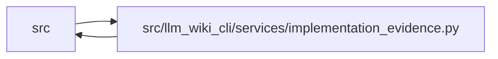

# implementation_evidence Module

**Path:** `src/llm_wiki_cli/services/implementation_evidence.py`

## Description

Pure, bounded persistence and comparison of captured implementation syntax.

These observations describe syntax within one declaration scope. They do not
establish dependency, runtime behavior, or authored documentation correctness.

## Imports

| Source | Symbols |
|--------|---------|
| `.` | `python_implementation` |
| `.analysis_compatibility` | `component_record` |
| `__future__` | `annotations` |
| `collections.abc` | `Mapping` |
| `dataclasses` | `dataclass` |
| `hashlib` | `hashlib` |
| `json` | `json` |
| `re` | `re` |
| `types` | `MappingProxyType` |

## Local dependency map

<!-- Auto-generated local dependency summary. Do not edit by hand. -->

> Module-level dependencies exceed the generated-diagram limits, so the diagram and table below group them by top-level package. Counts report the number of module neighbors in each package.

### Internal neighbors

| Direction | Module |
|---|---|
| Inbound | `src` (15) |
| Outbound | `src` (2) |

> All 17 module neighbor(s) are summarized by package because the module-level view exceeds the 12-node limit.

## Classes

| Class | Line | Bases | Description |
|-------|------|-------|-------------|
| [ImplementationComparison](../entities/ImplementationComparison.md) | 714 | — | — |
| [ImplementationReport](../entities/ImplementationReport.md) | 739 | — | — |

## Functions

| Function | Signature | Decorators | Description |
|----------|-----------|------------|-------------|
| `_object` | `(value, fields, label)` | — | — |
| `_int` | `(value, maximum, label, minimum = 0)` | — | — |
| `_bool` | `(value, label)` | — | — |
| `_hash` | `(value, label, nullable = False)` | — | — |
| `_copy` | `(value)` | — | — |
| `_freeze` | `(value)` | — | — |
| `_thaw` | `(value)` | — | — |
| `validate_coordinate` | `(value, scope = None)` | — | — |
| `coordinate_key` | `(value)` | — | — |
| `_supported_producer` | `(row)` | — | — |
| `validate_implementation_evidence` | `(value) -> dict` | — | — |
| `_owner` | `(value)` | — | — |
| `_bounds` | `(value)` | — | — |
| `_row` | `(value)` | — | — |
| `validate_implementation_declarations` | `(value) -> dict` | — | — |
| `analysis_hash_from_producer` | `(producer) -> str \| None` | — | Reconstruct the recorded issuer identity from committed component records. |
| `_concept_parts` | `(concept)` | — | — |
| `validate_concept_implementation` | `(concept, *, producer = None, source_content_hashes = None, mapping = None) -> dict` | — | — |
| `_validate_detail_lineages` | `(observations, details, *, owner = None, complete = True)` | — | — |
| `validate_implementation_collection` | `(concepts, *, producer = None, complete = True)` | — | Crosscheck redundant primaries and detail ancestry in a full collection. |
| `project_concept_implementations` | `(observations, mappings, *, producer, source_content_hashes) -> dict` | — | Project exact already captured owners after manifest mapping finalization. |
| `validate_implementation_summary` | `(value: object) -> dict` | — | — |
| `compact_implementation_summary` | `(value: ImplementationComparison \| Mapping) -> dict` | — | — |
| `_analysis_scope` | `(value)` | — | — |
| `compare_implementation_observations` | `(recorded, live, *, analysis_scope = 'snapshot', coordinate = None, scope = None, expected_analysis_hash = None, source_captured = True, source_present = True, truncated = False) -> ImplementationComparison` | — | — |
| `compare_knowledge_implementation` | `(knowledge_or_concepts, implementation_observations, *, analysis_scope = 'snapshot', captured_paths = None, source_content_hashes = None, analysis_compatibility_hash = None, missing_source_paths = None) -> ImplementationReport` | — | — |
| `select_implementation_comparison` | `(report: ImplementationReport, selector: str) -> ImplementationComparison` | — | — |
| `validate_implementation_comparison` | `(value: object) -> dict` | — | Validate a report's shape/consistency, never attest its capture issuer. |
