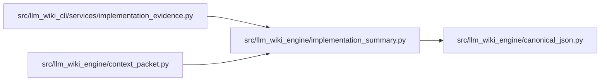

# implementation_summary Module

**Path:** `src/llm_wiki_engine/implementation_summary.py`

## Description

The implementation summary a context packet may carry.

A summary states whether captured executable syntax changed for one owner,
within fixed limitations. This module checks the summary's closed format; the
evidence it summarizes is produced and compared by the analyzing application.

## Imports

| Source | Symbols |
|--------|---------|
| `.canonical_json` | `compact_line_bytes` |
| `__future__` | `annotations` |
| `collections.abc` | `Mapping` |
| `json` | `json` |

## Local dependency map

<!-- Auto-generated local dependency summary. Do not edit by hand. -->

### Internal neighbors

| Direction | Module |
|---|---|
| Inbound | [implementation_evidence](../modules/implementation_evidence.md) |
| Inbound | [context_packet](../modules/context_packet.md) |
| Outbound | [canonical_json](../modules/canonical_json.md) |

## Functions

| Function | Signature | Decorators | Description |
|----------|-----------|------------|-------------|
| `_object` | `(value, fields, label)` | — | — |
| `_bool` | `(value, label)` | — | — |
| `_copy` | `(value)` | — | — |
| `validate_implementation_summary` | `(value: object) -> dict` | — | — |
