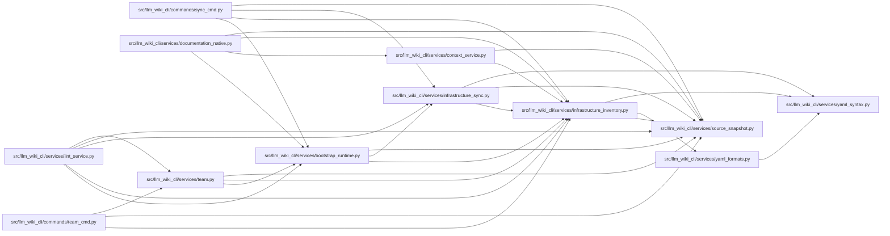

# infrastructure_inventory Module

**Path:** `src/llm_wiki_cli/services/infrastructure_inventory.py`

## Description

Structured observations for recognized infrastructure YAML formats.

The YAML path shares bounded node composition with Compose. It preserves scalar
lexemes and selects workflows, named CI/deployment formats, recognizable
Kubernetes resources and targeted runtime families from the captured candidates.
Kustomize routing precedes Kubernetes content detection. Kubernetes Lists and
CronJobs expose only supported resource fields; mixed streams and unrendered
templates retain qualifications without concrete resource observations.
Arbitrary YAML stays outside the inventory and is retained in discovery diagnostics.

## Imports

| Source | Symbols |
|--------|---------|
| `.source_snapshot` | `SourceSnapshot`, `build_source_snapshot` |
| `.yaml_formats` | `parse_extended_yaml` |
| `.yaml_syntax` | `load_yaml_documents`, `yaml_mapping`, `yaml_scalar` |
| `__future__` | `annotations` |
| `pathlib` | `Path` |
| `re` | `re` |
| `typing` | `Iterable` |

## Local dependency map

<!-- Auto-generated local dependency summary. Do not edit by hand. -->

### Internal neighbors

| Direction | Module |
|---|---|
| Inbound | [sync_cmd](../modules/sync_cmd.md) |
| Inbound | [team_cmd](../modules/team_cmd.md) |
| Inbound | [bootstrap_runtime](../modules/bootstrap_runtime.md) |
| Inbound | [context_service](../modules/context_service.md) |
| Inbound | [documentation_native](../modules/documentation_native.md) |
| Inbound | [infrastructure_sync](../modules/infrastructure_sync.md) |
| Inbound | [lint_service](../modules/lint_service.md) |
| Inbound | [team](../modules/team.md) |
| Outbound | [source_snapshot](../modules/source_snapshot.md) |
| Outbound | [yaml_formats](../modules/yaml_formats.md) |
| Outbound | [yaml_syntax](../modules/yaml_syntax.md) |

## Functions

| Function | Signature | Decorators | Description |
|----------|-----------|------------|-------------|
| `infrastructure_page_name` | `(source_path: str) -> str` | — | Return the canonical infrastructure page stem for *source_path*. |
| `infrastructure_display_label` | `(source_path: str, info: dict) -> str` | — | Return a human-friendly index label for an infrastructure entry. |
| `get_yaml_infrastructure_inventory` | `(src_dir: str \| Path, *, source_snapshot: SourceSnapshot \| None = None) -> dict[str, dict]` | — | Discover recognized infrastructure and runtime/config YAML files. |
| `parse_runtime_config_yaml` | `(rel_path: str, text: str) -> dict \| None` | — | Parse recognized runtime/config YAML families into documentation models. |
| `parse_prometheus_config` | `(text: str) -> dict` | — | Observe Prometheus scrape configuration without evaluating it. |
| `parse_prometheus_rules` | `(text: str) -> dict` | — | Observe Prometheus recording/alerting rule groups. |
| `parse_grafana_provisioning` | `(text: str, rel_path: str) -> dict` | — | Observe Grafana provisioning datasource or dashboard files. |
| `parse_promtail_config` | `(text: str) -> dict` | — | Observe Promtail client and scrape configuration. |
| `parse_loki_config` | `(text: str) -> dict` | — | Observe Loki server and schema settings. |
| `parse_envoy_config` | `(text: str) -> dict` | — | Observe Envoy listener, cluster, and admin port summaries. |
| `parse_buf_config` | `(text: str, rel_path: str) -> dict` | — | Observe Buf module or generation configuration. |
| `parse_model_service_config` | `(text: str, rel_path: str) -> dict` | — | Observe service-local model runtime settings. |
| `parse_github_actions_workflow` | `(text: str) -> dict` | — | Observe GitHub Actions workflow triggers, jobs, and direct steps. |
| `parse_kubernetes_manifest` | `(text: str) -> dict` | — | Observe an entirely Kubernetes stream, including Lists and CronJobs. |
| `_is_github_actions_path` | `(rel_path: str) -> bool` | — | — |
| `_is_kubernetes_path` | `(rel_path: str) -> bool` | — | — |
| `_is_kubernetes_document` | `(document: object) -> bool` | — | — |
| `_kubernetes_leaves` | `(document: object) -> list[dict] \| None` | — | — |
| `_kubernetes_resource` | `(document: dict) -> dict` | — | — |
| `_single_mapping` | `(text: str) -> tuple[dict, list[str]]` | — | — |
| `_list` | `(value: object) -> list` | — | — |
| `_mappings` | `(value: object) -> list[dict]` | — | — |
| `_strings` | `(value: object) -> list[str]` | — | — |
| `_named_items` | `(value: object, key: str = 'name') -> list[str]` | — | — |
| `_scalar_mapping` | `(value: object) -> dict[str, str]` | — | — |
| `_recursive_scalars` | `(value: object, key: str) -> list[str]` | — | — |
| `_first_scalar` | `(value: object, key: str) -> str` | — | — |
| `_unique_values` | `(values: Iterable[str]) -> list[str]` | — | — |