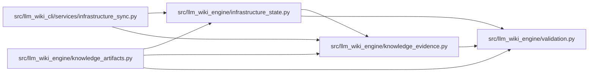

# infrastructure_state Module

**Path:** `src/llm_wiki_engine/infrastructure_state.py`

## Description

Persisted infrastructure state: its format and the evidence it projects.

The state records repository-relative source/page mappings and binds each
rendered observation to the exact source bytes and the normalized parser
result. It contains no timestamps, absolute paths, or source literals.

## Imports

| Source | Symbols |
|--------|---------|
| `__future__` | `annotations` |
| `copy` | `deepcopy` |
| `llm_wiki_engine.knowledge_evidence` | `ConceptObservationBasis`, `build_infrastructure_observation_basis`, `is_valid_sha256` |
| `llm_wiki_engine.validation` | `is_portable_relative_path` |
| `pathlib` | `PurePosixPath` |
| `typing` | `Mapping` |

## Local dependency map

<!-- Auto-generated local dependency summary. Do not edit by hand. -->

### Internal neighbors

| Direction | Module |
|---|---|
| Inbound | [infrastructure_sync](../modules/infrastructure_sync.md) |
| Inbound | [knowledge_artifacts](../modules/knowledge_artifacts.md) |
| Outbound | [knowledge_evidence](../modules/knowledge_evidence.md) |
| Outbound | [validation](../modules/validation.md) |

## Classes

| Class | Line | Bases | Description |
|-------|------|-------|-------------|
| [InfrastructureSyncError](../entities/InfrastructureSyncError.md) | 27 | `ValueError` | Persisted infrastructure state is unsafe or internally inconsistent. |

## Functions

| Function | Signature | Decorators | Description |
|----------|-----------|------------|-------------|
| `_prior_infrastructure_state` | `(generation_inputs: Mapping[str, object] \| None) -> dict[str, object]` | — | — |
| `_valid_repository_path` | `(value: str) -> bool` | — | — |
| `_valid_page_path` | `(value: object) -> bool` | — | — |
| `_record_mapping` | `(value: object, *, field_name: str) -> dict[str, dict[str, object]]` | — | — |
| `validate_infrastructure_generation_input` | `(generation_inputs: Mapping[str, object] \| None) -> None` | — | Reject an unsafe persisted v1 infrastructure mapping. |
| `infrastructure_evidence_by_page` | `(generation_inputs: Mapping[str, object] \| None) -> dict[str, ConceptObservationBasis]` | — | Project persisted current/removal records into native concept evidence. |
