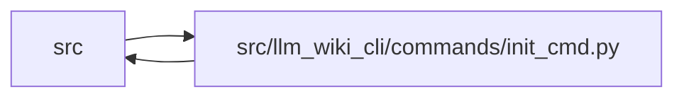

# init_cmd Module

**Path:** `src/llm_wiki_cli/commands/init_cmd.py`

## Description

Creates or refreshes the wiki scaffold, managed agent instructions, and local
agent configuration after validating existing paths, configuration, source
selection, and agent ownership. Existing compatible preferences survive a
refresh; ambiguous or unsafe state requires recovery before writes proceed.

`--prepare-extractors` adds a setup step before provisioning. It prepares the
selected helper languages, reuses valid cached artifacts, and stops on failed
preparation before changing the scaffold or agent configuration. The flag is
specific to that invocation. `--helper-cache-dir` selects its cache and requires
the preparation flag; it does not become a saved analysis preference.

## Imports

| Source | Symbols |
|--------|---------|
| `..config` | `AgentConfigState`, `CLI_AGENTS`, `DEFAULT_WIKI_DIR`, `config_requires_manual_recovery`, `get_agent_config_path`, `inspect_config`, `require_committed_config`, `require_config_inspection_unchanged`, `require_safe_config_path`, `validate_path`, `write_config` |
| `..services.current_contracts` | `current_contract_defaults`, `upgrade_current_knowledge` |
| `..services.extractor_helpers` | `helper_preparation_failure_hint` |
| `..services.filesystem_guard` | `atomic_write_guarded_bytes`, `ensure_guarded_directory`, `unlink_guarded_bytes` |
| `..services.helper_preparation` | `ensure_source_helpers` |
| `..services.rendering_lifecycle` | `reference_recovery_command`, `select_render_profile` |
| `..services.schema` | `CONSTRAINT_START`, `SCHEMA_FILENAMES`, `ManagedSchemaBlockError`, `ManagedSchemaBlockState`, `ManagedSchemaPathError`, `SchemaRenderProfile`, `build_schema_content`, `classify_managed_schema_block`, `decode_managed_document_bytes`, `encode_managed_document_text`, `replace_schema_block_content`, `require_managed_schema_profile`, `require_replaceable_managed_schema`, `require_safe_schema_path` |
| `..services.skills` | `REFERENCE_SKILL_ID`, `ReferenceSkillState`, `_provision_reference_skill_guarded`, `list_bundled_skills`, `skills_install_dir`, `verify_reference_skill` |
| `..services.source_selection` | `SourceSelectionError`, `resolve_source_selection` |
| `..services.wiki_lifecycle` | `WikiScaffoldPathError`, `provision_wiki_scaffold`, `require_safe_wiki_scaffold` |
| `.upgrade_cmd` | `_seed_legacy_for_current_defaults` |
| `__future__` | `annotations` |
| `pathlib` | `Path` |
| `shutil` | `shutil` |
| `sys` | `sys` |

## Local dependency map

<!-- Auto-generated local dependency summary. Do not edit by hand. -->

> Module-level dependencies exceed the generated-diagram limits, so the diagram and table below group them by top-level package. Counts report the number of module neighbors in each package.

### Internal neighbors

| Direction | Module |
|---|---|
| Inbound | `src` (2) |
| Outbound | `src` (11) |

> All 13 module neighbor(s) are summarized by package because the module-level view exceeds the 12-node limit.

## Functions

| Function | Signature | Decorators | Description |
|----------|-----------|------------|-------------|
| `_managed_schema_agents` | `() -> tuple[str, ...]` | — | Return agents with one safely readable managed schema in the checkout. |
| `run` | `(args)` | — | — |