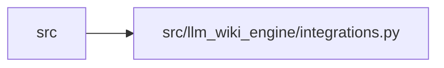

# integrations Module

**Path:** `src/llm_wiki_engine/integrations.py`

## Description

Providers the knowledge core borrows from the application that embeds it.

The knowledge core stores, validates and maintains knowledge without knowing
how sources are analyzed. A few of its checks need that knowledge: concept
implementation evidence comes from a language analysis, source snapshots come
from the application's view of the source tree, and some operations accept
only objects the application issued. The application names a module for each
capability below; the engine imports it on first use and reads its attributes
at call time, so a replaced attribute takes effect immediately.

A capability nobody provided fails closed with :class:`IntegrationUnavailable`.

Providers are resolved per context. :func:`provide` names process-wide
defaults. An :class:`IntegrationSet` names providers for one scope, entered with
:func:`using_integrations`; inside it the set's providers win, and a set built
with ``inherit=False`` hides the process-wide defaults entirely. Two engines in
one process can therefore use different providers without seeing each other's.

## Imports

| Source | Symbols |
|--------|---------|
| `__future__` | `annotations` |
| `collections.abc` | `Iterator`, `Mapping` |
| `contextlib` | `contextmanager` |
| `contextvars` | `ContextVar` |
| `importlib` | `importlib` |
| `re` | `re` |
| `types` | `MappingProxyType`, `ModuleType` |

## Local dependency map

<!-- Auto-generated local dependency summary. Do not edit by hand. -->

> Module-level dependencies exceed the generated-diagram limits, so the diagram and table below group them by top-level package. Counts report the number of module neighbors in each package.

### Internal neighbors

| Direction | Module |
|---|---|
| Inbound | `src` (16) |

> All 16 module neighbor(s) are summarized by package because the module-level view exceeds the 12-node limit.

## Classes

| Class | Line | Bases | Description |
|-------|------|-------|-------------|
| [IntegrationUnavailable](../entities/IntegrationUnavailable.md) | 60 | `LookupError` | The application did not provide a capability the knowledge core needs. |
| [IntegrationSet](../entities/IntegrationSet.md) | 71 | — | Provider modules for some capabilities, used inside one scope. |

## Functions

| Function | Signature | Decorators | Description |
|----------|-----------|------------|-------------|
| `_check` | `(capability: object, module: object) -> None` | — | — |
| `using_integrations` | `(integrations: IntegrationSet) -> Iterator[IntegrationSet]` | `@contextmanager` | Resolve capabilities inside the block with ``integrations`` first. |
| `provide` | `(modules: Mapping[str, str]) -> None` | — | Name the process-wide default provider of each capability, once each. |
| `_resolve` | `(capability: str) -> str \| None` | — | — |
| `provider` | `(capability: str) -> ModuleType` | — | Return the module providing *capability* here, importing it on first use. |
| `attributes` | `(capability: str, *names: str) -> tuple` | — | Read *names* from the provider of *capability* now, as a lazy import would. |
| `provided` | `() -> Mapping[str, str]` | — | The provider module each capability resolves to in this context. |
| `defaults` | `() -> Mapping[str, str]` | — | The process-wide default provider named for each capability so far. |
