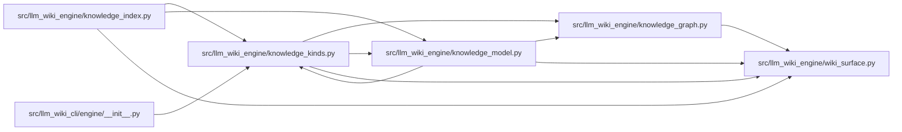

# knowledge_kinds Module

**Path:** `src/llm_wiki_engine/knowledge_kinds.py`

## Description

The concept, relationship and graph-edge kinds a knowledge index may use.

The ``llm-wiki-knowledge/v1`` format fixes its built-in kinds and lets any
other concept, relationship or typed-graph edge kind appear as a qualified
``namespace/name`` value. A :class:`KindRegistry` lets a host declare those
custom kinds as part of its domain:

* a :class:`ConceptKindSpec` names the page kinds a custom concept kind may
  appear on and whether it is document-only (no structural evidence);
* a :class:`RelationshipKindSpec` declares a custom relationship or typed-graph
  edge kind;
* ``undeclared="reject"`` refuses custom kinds the registry does not declare,
  while the default ``"accept"`` keeps the format's open behavior.

Page kinds are fixed by the v1 format and cannot be added; the registry lists
them for discovery. Built-in kinds keep the rules the format defines.

The checks run when a knowledge index is parsed, and the registry is part of
the validation identity, so a model validated under one registry is not
trusted under another. Context packets do not consult the registry: they
validate the same way for every consumer.

## Imports

| Source | Symbols |
|--------|---------|
| `.knowledge_model` | `PAGE_KIND_TO_CONCEPT_KIND`, `QUALIFIED_NAME_PATTERN`, `ConceptKind`, `EvidenceState`, `KnowledgeModelError`, `Origin`, `RelationshipKind`, `ConceptRecord`, `KnowledgeIndex` |
| `__future__` | `annotations` |
| `collections.abc` | `Iterator`, `Mapping` |
| `contextlib` | `contextmanager` |
| `contextvars` | `ContextVar` |
| `dataclasses` | `dataclass`, `replace` |
| `llm_wiki_engine.knowledge_graph` | `CORE_RELATIONSHIP_KINDS` |
| `llm_wiki_engine.wiki_surface` | `PageKind` |
| `re` | `re` |
| `typing` | `TYPE_CHECKING`, `Any`, `Literal` |

## Local dependency map

<!-- Auto-generated local dependency summary. Do not edit by hand. -->

### Internal neighbors

| Direction | Module |
|---|---|
| Inbound | [engine___init__](../modules/engine___init__.md) |
| Inbound | [knowledge_index](../modules/knowledge_index.md) |
| Inbound | [knowledge_model](../modules/knowledge_model.md) |
| Outbound | [knowledge_graph](../modules/knowledge_graph.md) |
| Outbound | [knowledge_model](../modules/knowledge_model.md) |
| Outbound | [wiki_surface](../modules/wiki_surface.md) |

## Classes

| Class | Kind | Line | Bases / Target | Description |
|-------|------|------|----------------|-------------|
| [UndeclaredPolicy](../entities/UndeclaredPolicy.md) | Type alias | 48 | `Literal['accept', 'reject']` | — |
| [ConceptKindSpec](../entities/ConceptKindSpec.md) | Class | 68 | — | One concept kind and the page kinds its concepts may appear on. |
| [RelationshipKindSpec](../entities/RelationshipKindSpec.md) | Class | 92 | — | One relationship or typed-graph edge kind. |
| [KindRegistry](../entities/KindRegistry.md) | Class | 144 | — | Declared concept, relationship and typed-graph edge kinds. |

## Functions

| Function | Signature | Decorators | Description |
|----------|-----------|------------|-------------|
| `_require_name` | `(name: object, *, builtin: frozenset[str]) -> str` | — | — |
| `_builtin_concept_specs` | `() -> tuple[ConceptKindSpec, ...]` | — | — |
| `_unique` | `(specs: tuple, family: str) -> dict` | — | — |
| `_require_family` | `(specs: object, spec_type: type, builtin: tuple, family: str) -> tuple` | — | — |
| `current_kinds` | `() -> KindRegistry` | — | The registry chosen for this context, or :data:`DEFAULT_KINDS`. |
| `using_kinds` | `(registry: KindRegistry) -> Iterator[KindRegistry]` | `@contextmanager` | Check knowledge index kinds inside the block with ``registry``. |
