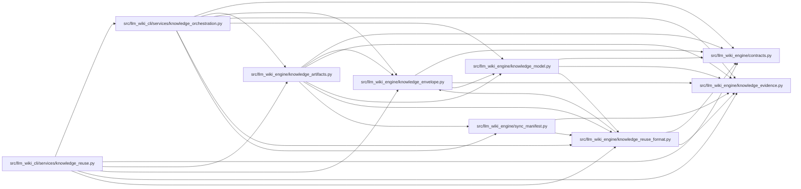

# knowledge_reuse_format Module

**Path:** `src/llm_wiki_engine/knowledge_reuse_format.py`

## Description

Knowledge reuse commitments: their format and their binding to artifacts.

A sync may reuse a committed knowledge projection only when the manifest and
the knowledge bundle carry the same versioned commitment to every input.

## Imports

| Source | Symbols |
|--------|---------|
| `.knowledge_envelope` | `INVENTORY_HASH_EXTENSION` |
| `__future__` | `annotations` |
| `collections.abc` | `Mapping` |
| `dataclasses` | `asdict`, `replace` |
| `llm_wiki_engine.contracts` | `KNOWLEDGE_REUSE_SCHEMA_VERSION` |
| `llm_wiki_engine.knowledge_evidence` | `hash_json`, `is_valid_sha256` |

## Local dependency map

<!-- Auto-generated local dependency summary. Do not edit by hand. -->

### Internal neighbors

| Direction | Module |
|---|---|
| Inbound | [knowledge_orchestration](../modules/knowledge_orchestration.md) |
| Inbound | [knowledge_reuse](../modules/knowledge_reuse.md) |
| Inbound | [knowledge_artifacts](../modules/knowledge_artifacts.md) |
| Inbound | [knowledge_model](../modules/knowledge_model.md) |
| Inbound | [sync_manifest](../modules/sync_manifest.md) |
| Outbound | [llm_wiki_engine_contracts](../modules/llm_wiki_engine_contracts.md) |
| Outbound | [knowledge_envelope](../modules/knowledge_envelope.md) |
| Outbound | [knowledge_evidence](../modules/knowledge_evidence.md) |

## Functions

| Function | Signature | Decorators | Description |
|----------|-----------|------------|-------------|
| `validate_reuse_commitment` | `(value: object) -> dict` | — | — |
| `manifest_lifecycle_hash` | `(manifest) -> str` | — | — |
| `repository_input_hash` | `(record) -> str` | — | — |
| `validate_reuse_artifact_parity` | `(knowledge, manifest) -> None` | — | A manifest hint alone never authorizes reuse of a projection. |
