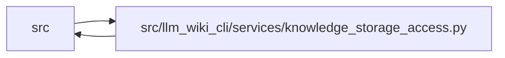

# knowledge_storage_access Module

**Path:** `src/llm_wiki_cli/services/knowledge_storage_access.py`

## Description

Captures selected knowledge records, their Markdown and required governance or ordinary-maintenance authority through guarded filesystem reads. Indexed manifests v6 and v8 use committed headers and necessary policy catalogs; inline manifests retain complete parsing. Adopted v7/v8 additionally binds the matching maintenance marker, state commitments and consumed projections. Unread ledger membership remains explicitly unverified for selected v8 reads. The caller must run the final guarded recheck before publication; unread records remain outside the validated scope.

Graph expansion resolves anchor concepts as internal dependencies even when the caller requests only edges, relationships or sections. Their reads, Markdown bindings and final rechecks remain charged and verified, while the output keeps only the requested collections. Truncated anchor selection remains disclosed as incomplete after expansion.

## Imports

| Source | Symbols |
|--------|---------|
| `.concept_identity` | `natural_key_for` |
| `.contracts` | `GOVERNANCE_EXTENSION_KEY` |
| `.implementation_evidence` | `IMPLEMENTATION_KEY`, `DECLARATIONS_KEY`, `validate_concept_implementation`, `validate_implementation_collection` |
| `.io` | `decode_markdown_bytes` |
| `.knowledge_artifacts` | `_decode_json_object`, `_decode_json_object`, `_decode_json_object` |
| `.knowledge_envelope` | `EvaluatedEnvelope` |
| `.knowledge_governance` | `GOVERNANCE_FILENAME`, `parse_governance_ledger`, `lifecycle_state_by_uid` |
| `.knowledge_model` | `_parse_bundle`, `parse_knowledge_index` |
| `.knowledge_packs` | `PACKED_SCHEMAS`, `open_knowledge_store` |
| `.knowledge_storage` | `LOGICAL_SCHEMA`, `MAX_EXPANDED_BYTES`, `MAX_OBJECT_BYTES`, `MAX_ROOT_BYTES`, `ROOT_FILENAME`, `STORE_SCHEMA`, `KnowledgeSlice`, `KnowledgeStorageError`, `KnowledgeStoreReader`, `canonical_bytes`, `digest` |
| `.knowledge_storage_io` | `StorageReadSession` |
| `.maintenance_projection` | `BINDING_KEY`, `validate_maintenance_binding`, `RECORD_KEY`, `BINDING_KEY`, `BINDING_KEY`, `RECORD_KEY`, `validate_maintenance_projection`, `RECORD_KEY` |
| `.maintenance_protocol` | `ADOPTION_FILENAME` |
| `.maintenance_state` | `validate_maintenance_adoption` |
| `.manifest_storage` | `ValidatedManifestHeader`, `read_manifest_header`, `ManifestStoreReader` |
| `.sync_manifest` | `MANIFEST_FILENAME` |
| `__future__` | `annotations` |
| `collections.abc` | `Iterable` |
| `dataclasses` | `dataclass`, `field` |
| `json` | `json` |
| `pathlib` | `Path` |
| `typing` | `Any` |

## Local dependency map

<!-- Auto-generated local dependency summary. Do not edit by hand. -->

> Module-level dependencies exceed the generated-diagram limits, so the diagram and table below group them by top-level package. Counts report the number of module neighbors in each package.

### Internal neighbors

| Direction | Module |
|---|---|
| Inbound | `src` (3) |
| Outbound | `src` (16) |

> All 19 module neighbor(s) are summarized by package because the module-level view exceeds the 12-node limit.

## Classes

| Class | Line | Bases | Description |
|-------|------|-------|-------------|
| [ScopedKnowledgeRead](../entities/ScopedKnowledgeRead.md) | 31 | — | Request-owned observations that require a final authoritative recheck. |

## Functions

| Function | Signature | Decorators | Description |
|----------|-----------|------------|-------------|
| `capture_knowledge_slice` | `(wiki_dir: str \| Path, selectors: Iterable[str], *, max_bytes: int = 8388608, max_records: int = 1000, max_expanded_bytes: int = 16777216, include_graph: bool = False, collections: Iterable[str] \| None = None, coalesce_rechecks: bool = False, cancelled = None) -> ScopedKnowledgeRead` | — | Capture selected stored observations without enumerating the wiki tree. |
| `_capture_slice` | `(session, keys, max_bytes, max_records, max_expanded_bytes, include_graph, collections)` | — | — |
| `_captured_adoption_marker` | `(session) -> dict[str, Any] \| None` | — | — |
