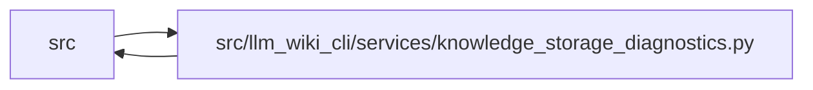

# knowledge_storage_diagnostics Module

**Path:** `src/llm_wiki_cli/services/knowledge_storage_diagnostics.py`

## Description

Reports physical sizes and complete integrity through one native materialization, using statistics captured during that validation. Logical inspection and comparison retain full snapshot validation by default. Explicit selectors provide a separate scoped inspection whose output names its narrower validation boundary.

Storage reporting retains a failed storage-limit result with bounded size observations and an explicit prune-preview recovery route. Quick inspection leaves reachability unknown; a full valid snapshot separates active references from unreferenced candidates, whose bytes are not validated for deletion. Namespace unknowns and incomplete inspection never authorize cleanup.

Logical comparison uses canonical JSON values, preserving Boolean-versus-number distinctions even inside nested extension data. Equivalent records remain independent of physical packing and object-key order. Output item and byte bounds still disclose omitted records or values; a partial result never establishes complete review.

Logical review continuations bind both snapshot commitments, native root locations, operation, selection and canonical ordering. Pages retain global totals and single-response completeness while separately reporting remaining records and enumeration completion. Oversized values or identities can be recovered as exact canonical row bytes through review-bound offset chunks, with full-row hashes and sizes. Every page and chunk repeats its original validation/materialization scope; bounded output does not establish a bounded scan, live freshness or approval.

## Imports

| Source | Symbols |
|--------|---------|
| `.contracts` | `TYPED_GRAPH_EXTENSION_KEY`, `SECTION_OWNERSHIP_EXTENSION_KEY` |
| `.knowledge_artifacts` | `validated_artifact_bytes` |
| `.knowledge_index` | `_model_to_payload` |
| `.knowledge_loader` | `load_knowledge_state` |
| `.knowledge_model` | `_concept_to_payload`, `_relationship_to_payload` |
| `.knowledge_packs` | `PACKED_SCHEMAS`, `packed_format`, `PACK_NAME`, `INDEX_NAME`, `INDEX_PAGE_NAME`, `INDEX_PAGE_BYTES`, `MAX_PACK_BYTES`, `MAX_INDEX_BYTES`, `parse_packed_root` |
| `.knowledge_storage` | `GIT_FAILURE_BYTES`, `GIT_WARNING_BYTES`, `MAX_EXPANDED_BYTES`, `MAX_OBJECT_BYTES`, `MAX_ROOT_BYTES`, `ROOT_FILENAME`, `STORE_SCHEMA`, `KnowledgeStorageError`, `canonical_bytes`, `parse_store_root`, `digest`, `digest`, `digest`, `digest` |
| `.knowledge_storage_access` | `capture_knowledge_slice` |
| `.knowledge_storage_io` | `_absolute_path`, `read_guarded` |
| `.knowledge_storage_lifecycle` | `stored_object_paths` |
| `.manifest_storage` | `OBJECT_NAME`, `OBJECT_LIMIT` |
| `.sync_manifest` | `MANIFEST_FILENAME` |
| `.wiki_surface_index` | `SURFACE_INDEX_FILENAME` |
| `__future__` | `annotations` |
| `base64` | `base64` |
| `binascii` | `binascii` |
| `heapq` | `heapq` |
| `json` | `json` |
| `os` | `os` |
| `pathlib` | `Path` |
| `re` | `re` |
| `subprocess` | `subprocess` |
| `threading` | `Event`, `Thread` |
| `typing` | `Any` |

## Local dependency map

<!-- Auto-generated local dependency summary. Do not edit by hand. -->

> Module-level dependencies exceed the generated-diagram limits, so the diagram and table below group them by top-level package. Counts report the number of module neighbors in each package.

### Internal neighbors

| Direction | Module |
|---|---|
| Inbound | `src` (2) |
| Outbound | `src` (13) |

> All 15 module neighbor(s) are summarized by package because the module-level view exceeds the 12-node limit.

## Functions

| Function | Signature | Decorators | Description |
|----------|-----------|------------|-------------|
| `_git` | `(root: Path, arguments: list[str], *, input_bytes: bytes \| None = None, maximum: int = 16777216) -> tuple[int, bytes]` | — | Drain both pipes with hard byte/time bounds; never invoke a shell. |
| `inspect_git_range` | `(project: str \| Path, *, base: str, head: str) -> dict[str, Any]` | — | Inspect every blob in head minus base, including subsequently deleted files. |
| `storage_report` | `(wiki_dir: str \| Path, *, full: bool = False, git_base: str \| None = None, git_head: str \| None = None) -> dict[str, Any]` | — | — |
| `_retention_recovery` | `(root: Path) -> dict[str, Any]` | — | Offer the maintained preview route, never a size-based cleanup decision. |
| `_storage_report` | `(root: Path, report: dict[str, Any], *, full: bool, git_base: str \| None, git_head: str \| None) -> dict[str, Any]` | — | Inspect within existing bounds; the caller retains storage-limit gaps. |
| `_review_records` | `(wiki_dir: str \| Path) -> tuple[dict[str, Any], dict[str, Any]]` | — | Logical review keys preserve duplicates and avoid physical pack identities. |
| `_review_cursor` | `(review_id: str, offset: int) -> str` | — | — |
| `_review_position` | `(cursor: str, review_id: str, total: int) -> int` | — | — |
| `_review_row` | `(key: str, index: int, current: dict, previous: dict, diff: bool) -> dict[str, Any]` | — | — |
| `_review_record_chunk` | `(row: dict, *, review_id: str, offset: int, max_bytes: int, validation_scope: str) -> dict[str, Any]` | — | Deliver exact canonical row bytes, including identities too large for one page. |
| `review_storage` | `(wiki_dir: str \| Path, *, against: str \| Path \| None = None, limit: int = 100, max_bytes: int = 262144, selectors = None, cursor: str \| None = None, record_index: int \| None = None, review_id: str \| None = None, record_offset: int = 0) -> dict[str, Any]` | — | Page logical snapshots or recover an exact row under the same output bounds. |
