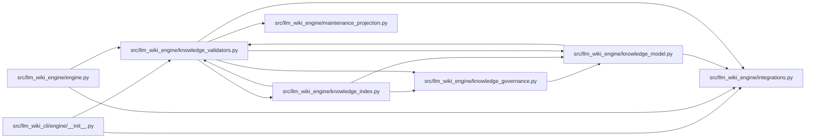

# knowledge_validators Module

**Path:** `src/llm_wiki_engine/knowledge_validators.py`

## Description

The checks every parsed knowledge index must pass, as one registry.

:func:`~llm_wiki_engine.knowledge_model.parse_knowledge_index` first
parses the core record shapes, then runs each :class:`ModelValidator` of the
active :class:`ValidatorRegistry` in order. The built-in registry checks
implementation evidence, the maintenance projection and the governance
projection, in that order: governance relies on the other reserved
extensions being valid.

The registry also names the modules whose functions and policy values define
acceptance. Its :meth:`ValidatorRegistry.identity` snapshots them, so a
validation receipt or cached validated model stops being trusted as soon as a
check, a module it depends on, or the registry itself changes.

A host extends validation by adding a validator and running work inside
:func:`using_validators`, or by passing the registry to an engine. The choice
is scoped to the current context, so engines with different registries can
run side by side.

## Imports

| Source | Symbols |
|--------|---------|
| `.knowledge_governance` | `validate_governance_projection` |
| `.knowledge_index` | `_validation_callable_identity`, `_validation_module_identity` |
| `.knowledge_model` | `KnowledgeIndex`, `KnowledgeModelError`, `KnowledgeModelError`, `KnowledgeModelError`, `KnowledgeModelError` |
| `.maintenance_projection` | `validate_maintenance_projection` |
| `__future__` | `annotations` |
| `collections.abc` | `Callable`, `Iterator` |
| `contextlib` | `contextmanager` |
| `contextvars` | `ContextVar` |
| `dataclasses` | `dataclass`, `replace` |
| `importlib` | `importlib` |
| `llm_wiki_engine.integrations` | `attributes`, `provider` |
| `typing` | `TYPE_CHECKING` |

## Local dependency map

<!-- Auto-generated local dependency summary. Do not edit by hand. -->

### Internal neighbors

| Direction | Module |
|---|---|
| Inbound | [engine___init__](../modules/engine___init__.md) |
| Inbound | [engine](../modules/engine.md) |
| Inbound | [knowledge_index](../modules/knowledge_index.md) |
| Inbound | [knowledge_model](../modules/knowledge_model.md) |
| Outbound | [integrations](../modules/integrations.md) |
| Outbound | [knowledge_governance](../modules/knowledge_governance.md) |
| Outbound | [knowledge_index](../modules/knowledge_index.md) |
| Outbound | [knowledge_model](../modules/knowledge_model.md) |
| Outbound | [maintenance_projection](../modules/maintenance_projection.md) |

## Classes

| Class | Line | Bases | Description |
|-------|------|-------|-------------|
| [ModelValidator](../entities/ModelValidator.md) | 39 | — | One acceptance check run on every parsed knowledge index. |
| [ValidatorRegistry](../entities/ValidatorRegistry.md) | 66 | — | Ordered model validators plus the modules that define core parsing. |

## Functions

| Function | Signature | Decorators | Description |
|----------|-----------|------------|-------------|
| `_check_implementation_evidence` | `(model: KnowledgeIndex) -> None` | — | — |
| `_check_maintenance_projection` | `(model: KnowledgeIndex) -> None` | — | — |
| `_check_governance_projection` | `(model: KnowledgeIndex) -> None` | — | — |
| `_module` | `(name: str) -> str` | — | — |
| `_module_name` | `(name: str) -> str` | — | — |
| `current_validators` | `() -> ValidatorRegistry` | — | The registry chosen for this context, or :data:`DEFAULT_VALIDATORS`. |
| `using_validators` | `(registry: ValidatorRegistry) -> Iterator[ValidatorRegistry]` | `@contextmanager` | Validate knowledge indexes inside the block with ``registry``. |
