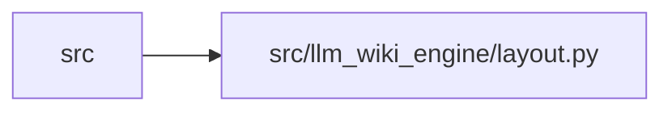

# layout Module

**Path:** `src/llm_wiki_engine/layout.py`

## Description

The names a wiki and its machine state use on disk.

Every file and directory name the knowledge core reads or writes is defined
once, here, as a field of :class:`Layout`. Modules use :data:`DEFAULT_LAYOUT`
instead of repeating the names. The default layout is the only supported one;
changing a name changes the on-disk format.

## Imports

| Source | Symbols |
|--------|---------|
| `__future__` | `annotations` |
| `dataclasses` | `dataclass` |

## Local dependency map

<!-- Auto-generated local dependency summary. Do not edit by hand. -->

> Module-level dependencies exceed the generated-diagram limits, so the diagram and table below group them by top-level package. Counts report the number of module neighbors in each package.

### Internal neighbors

| Direction | Module |
|---|---|
| Inbound | `src` (42) |

> All 42 module neighbor(s) are summarized by package because the module-level view exceeds the 12-node limit.

## Classes

| Class | Line | Bases | Description |
|-------|------|-------|-------------|
| [Layout](../entities/Layout.md) | 15 | — | Where a wiki keeps its pages and machine state. |
