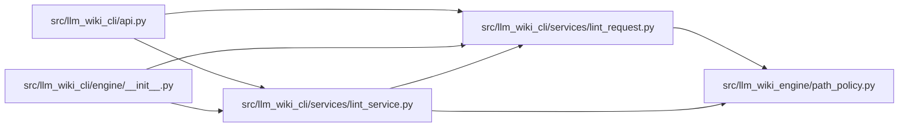

# lint_request Module

**Path:** `src/llm_wiki_cli/services/lint_request.py`

## Description

Typed lint inputs shared by the CLI, the Python API and engines.

Importing this module is cheap; the checks live in
:mod:`llm_wiki_cli.services.lint_service` and are loaded on first use.

## Imports

| Source | Symbols |
|--------|---------|
| `__future__` | `annotations` |
| `collections.abc` | `Iterable` |
| `dataclasses` | `dataclass` |
| `llm_wiki_engine.path_policy` | `DEFAULT_WIKI_DIR` |
| `pathlib` | `Path` |
| `typing` | `Literal` |

## Local dependency map

<!-- Auto-generated local dependency summary. Do not edit by hand. -->

### Internal neighbors

| Direction | Module |
|---|---|
| Inbound | [api](../modules/api.md) |
| Inbound | [engine___init__](../modules/engine___init__.md) |
| Inbound | [lint_service](../modules/lint_service.md) |
| Outbound | [path_policy](../modules/path_policy.md) |

## Classes

| Class | Line | Bases | Description |
|-------|------|-------|-------------|
| [LintRequest](../entities/lint_request_LintRequest.md) | 18 | — | One lint of ``wiki_root`` against ``source_root``. |
| [LintRequestError](../entities/LintRequestError.md) | 45 | `ValueError` | The lint request names a path the workspace policy rejects. |
