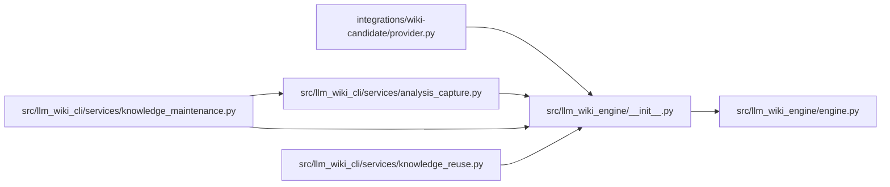

# __init__ Module

**Path:** `src/llm_wiki_engine/__init__.py`

## Description

Standard-library-only core of the LLM Wiki engine.

The modules in this package hold the parts of the engine that need nothing
beyond the Python standard library: canonical JSON encodings and digests,
the host boundary (processes, environment, working directory, clock), path
and request validation, the knowledge graph and evidence vocabularies, wiki
surface and media rules, search ranking, and validators for the published
JSON formats. They import only the standard library and each other.

``agent-wiki-cli`` builds the code-documentation product on top of this
package. Its ``llm_wiki_cli.services.<module>`` import paths for these
modules remain available as aliases of the same module objects.

## Imports

| Source | Symbols |
|--------|---------|
| `.engine` | `Engine` |

## Local dependency map

<!-- Auto-generated local dependency summary. Do not edit by hand. -->

### Internal neighbors

| Direction | Module |
|---|---|
| Inbound | [provider](../modules/provider.md) |
| Inbound | [analysis_capture](../modules/analysis_capture.md) |
| Inbound | [knowledge_maintenance](../modules/knowledge_maintenance.md) |
| Inbound | [knowledge_reuse](../modules/knowledge_reuse.md) |
| Outbound | [engine](../modules/engine.md) |

## Functions

| Function | Signature | Decorators | Description |
|----------|-----------|------------|-------------|
| `__getattr__` | `(name: str)` | — | — |
