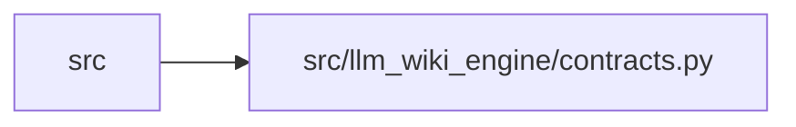

# contracts Module

**Path:** `src/llm_wiki_engine/contracts.py`

## Description

Stable machine-readable contracts exposed by source-adapter commands.

The extract contract stays at ``llm-wiki-extract/v1`` while data-flow metadata
is added as optional fields. Consumers must tolerate inventories without
``data_effects``, call argument summaries, top-level ``data_flows``, or the
versioned ``data_flow_details`` sibling because older payloads and non-Python
extractors may not emit them. A schema version bump is reserved for
incompatible shape changes to existing fields.

Static flow results may add ``analysis`` (``llm-wiki-callable-effect-coverage/v1``)
and per-step qualifications for callable records, source effect observations,
and collector totals. Flow assembly can be evaluated while effect analysis is
partial or unavailable. Observation counts describe captured static evidence;
unavailable collectors cannot establish that a handler body has no effects.
Known collector omissions qualify effect coverage as partial. Additive
``collector_counts`` and ``collector_observations`` retain observed, emitted,
and omitted counts for source steps with available totals; unknown counts
remain null and are excluded from the known subtotal.

Dockerfile records may add ``stage_schema_version`` (``llm-wiki-dockerfile-stages/v1``).
Each stage owns its source declarations and ordered ``instructions`` with source
lines. ``base_stage`` links an earlier named FROM stage; COPY --from does not
imply configuration inheritance. ``configuration_scope`` qualifies flat
configuration fields as final-stage declarations, rather than effective image
defaults. Aggregate COPY/ARG records retain their stage index (or null for
global ARG) and line, while ``global_build_args`` exposes pre-FROM declarations.
No external base-image inspection or build-argument evaluation is performed.

Dependency/load-order architecture decisions also stay additive under the
current extract contract: deep Python inventory may include ``data_effects`` on
function entries, including bounded ``boundary_effects`` for filesystem,
environment, process, network, output, and logging calls; ``module_calls`` only
when module-level side effects exist; ``main_block_calls`` for calls inside a
Python ``if __name__ == "__main__"`` guard; and ``extract --deep`` may include
a top-level ``data_flows`` list plus a top-level ``dependencies`` block.
The dependency block may contain versioned ``version_details`` records; its
legacy per-language ``versions`` map remains unchanged.
TypeScript imports may add ``type_only`` and ``type_only_declaration`` booleans
and ``runtime`` (``erased``, ``conditional``, or ``present``). A type-only
specifier erases its binding, but its statement can retain module evaluation.
Only guaranteed-erased declarations are excluded from startup constraints;
ordinary binding imports remain conditional on compiler emission. Dependency
projections may add possible startup ``import_time_edges``, ``type_only_edges``, ``conditional_import_time_edges``,
``type_cycles``, ``preserved_cycles``, and ``conditional_cycles`` without changing
coupling ``edges`` or the possible startup SCCs in ``cycles``. Preserved cycles
remain explicit even when compiler-dependent edges enlarge their components.
An optional import ``scope`` is a string. Malformed scope metadata cannot
establish known structural evidence; an unclassified scope does not prove that
an import is deferred or erased.
Python dependency reconciliation treats ``sys.stdlib_module_names`` as the
stdlib source when available, falls back to the bundled Python 3.9 list in
dependency analysis, and uses the curated import-to-distribution aliases there
with optional project overrides from ``[tool.llm-wiki.dependency-aliases]``.
Reconstructable Python contracts also remain additive: parameter ``kind``
values preserve declaration separators, while class/attribute records may add
enum members, type-alias targets, normalized Pydantic field state, model
configuration, and validator metadata. Extraction remains syntax-only and
consumers must tolerate these optional records being absent.
Deep TypeScript property records add an ``optional`` boolean for the explicit
question token. Names, types, and defaults retain their existing meanings;
neither a union with ``undefined`` nor an initializer determines optionality.
Deep Python inventory may additionally expose per-file ``frameworks.fastapi``
declarations and the payload may expose top-level ``api_contracts`` assembled
from static syntax or an authoritative source-contained OpenAPI export. These
records, their diagnostics, and entry-point ``routes`` remain optional under
``llm-wiki-extract/v1``.

The registry names the standalone normalization-diagnostic contract independently
of extraction, native evidence and CI/health envelopes. Versioned JSON diagnostic
text does not add fields to those outer contracts or change evidence hashes.
The diagnostic schema is packaged with the library, and consumers interpreting
the record must recognize its own version.

## Imports

| Source | Symbols |
|--------|---------|
| `__future__` | `annotations` |

## Local dependency map

<!-- Auto-generated local dependency summary. Do not edit by hand. -->

> Module-level dependencies exceed the generated-diagram limits, so the diagram and table below group them by top-level package. Counts report the number of module neighbors in each package.

### Internal neighbors

| Direction | Module |
|---|---|
| Inbound | `src` (54) |

> All 54 module neighbor(s) are summarized by package because the module-level view exceeds the 12-node limit.
