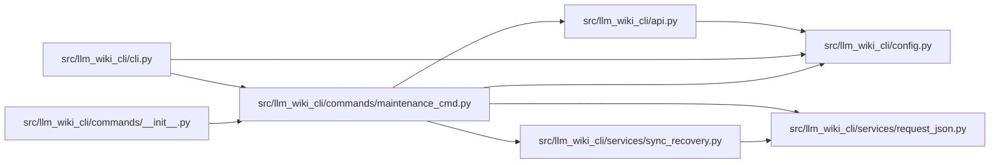

# maintenance_cmd Module

**Path:** `src/llm_wiki_cli/commands/maintenance_cmd.py`

## Description

CLI adapter for explicit ordinary maintenance review operations.

The separate `recover-new-pages` action validates the wiki inside the current
project, then forwards the rejection-bound hash and preview/apply option to the
new-page recovery service. Its recovery directory stays outside the wiki.
Adoption, status, acknowledgment and complete authority recovery retain their
existing API routes; removing new pages never acknowledges prose or repairs
missing authority.

## Imports

| Source | Symbols |
|--------|---------|
| `..` | `api` |
| `..config` | `validate_path` |
| `..services.request_json` | `load_request` |
| `..services.sync_recovery` | `recover_new_sync_pages` |
| `__future__` | `annotations` |
| `json` | `json` |

## Local dependency map

<!-- Auto-generated local dependency summary. Do not edit by hand. -->

### Internal neighbors

| Direction | Module |
|---|---|
| Inbound | [cli](../modules/cli.md) |
| Inbound | [commands___init__](../modules/commands___init__.md) |
| Outbound | [api](../modules/api.md) |
| Outbound | [config](../modules/config.md) |
| Outbound | [request_json](../modules/request_json.md) |
| Outbound | [sync_recovery](../modules/sync_recovery.md) |

## Functions

| Function | Signature | Decorators | Description |
|----------|-----------|------------|-------------|
| `_capture_options` | `(args)` | — | — |
| `_render_status` | `(result)` | — | — |
| `run` | `(args) -> None` | — | — |
