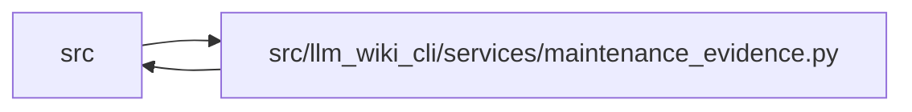

# maintenance_evidence Module

**Path:** `src/llm_wiki_cli/services/maintenance_evidence.py`

## Description

Captured source/semantic-section joins and pure durable reconciliation.

No source, Markdown, or ledger is reopened here. Absence needs an explicit
capture; omitted declarations and unselected inputs cannot prove deletion.

## Imports

| Source | Symbols |
|--------|---------|
| `.immutable` | `freeze` |
| `.implementation_evidence` | `DECLARATIONS_KEY`, `IMPLEMENTATION_KEY`, `validate_concept_implementation`, `validate_implementation_evidence` |
| `.knowledge_storage` | `digest` |
| `.maintenance_state` | `MaintenanceError`, `canonical_hash`, `maintenance_core`, `new_identity`, `validate_maintenance_adoption`, `validate_maintenance_state` |
| `.markdown_sections` | `parse_markdown_document` |
| `.python_implementation` | `comparison_id` |
| `.section_ownership` | `SectionOwnership`, `observe_page_sections` |
| `.sync_transitions` | `PageTransitionPlan` |
| `__future__` | `annotations` |
| `collections.abc` | `Mapping` |
| `copy` | `deepcopy` |
| `dataclasses` | `dataclass` |
| `typing` | `Any`, `Callable` |
| `urllib.parse` | `quote` |

## Local dependency map

<!-- Auto-generated local dependency summary. Do not edit by hand. -->

> Module-level dependencies exceed the generated-diagram limits, so the diagram and table below group them by top-level package. Counts report the number of module neighbors in each package.

### Internal neighbors

| Direction | Module |
|---|---|
| Inbound | `src` (4) |
| Outbound | `src` (8) |

> All 12 module neighbor(s) are summarized by package because the module-level view exceeds the 12-node limit.

## Classes

| Class | Line | Bases | Description |
|-------|------|-------|-------------|
| [MaintenanceCapture](../entities/MaintenanceCapture.md) | 99 | — | — |
| [MaintenanceTransfers](../entities/MaintenanceTransfers.md) | 648 | — | — |

## Functions

| Function | Signature | Decorators | Description |
|----------|-----------|------------|-------------|
| `captured_semantic_sections` | `(markdown: str, page_locator: str, page_kind, *, raw_content: bytes \| None = None) -> dict` | — | Exact raw section bytes joined to existing normalized ownership locators. |
| `owner_key` | `(coordinate, target) -> str` | — | — |
| `_mapping_values` | `(mapping)` | — | — |
| `_unavailable` | `(evidence, *, reason, source_hash)` | — | — |
| `_current_evidence` | `(concept, mapping, captures, hashes, selected, analysis_hash)` | — | — |
| `captured_observations_from_knowledge` | `(knowledge, *, content_by_page, page_source_mappings, captures = None, source_content_hashes = None, captured_paths = None, missing_source_paths = (), analysis_compatibility_hash = None, section_ownership = None, previous_state = None, known_absent_pages = (), raw_content_by_page = None) -> MaintenanceCapture` | — | Join actual current captures; unavailable old owners retain honest gaps. |
| `_event` | `(state, record_id, kind, **fields)` | — | — |
| `reconcile_pending_maintenance` | `(previous_state, marker, capture: MaintenanceCapture, *, confirmed_transfers = (), ambiguous_transfers = (), allocate_id: Callable[[], str] = new_identity) -> dict` | — | Preserve history, apply explicit transfer proofs, and reopen captured work. |
| `maintenance_transfers_from_page_plan` | `(previous_state, capture: MaintenanceCapture, page_plan, *, previous_raw_content_by_page) -> MaintenanceTransfers` | — | Use verified page owners and captured semantic sections, never names/hashes. |
