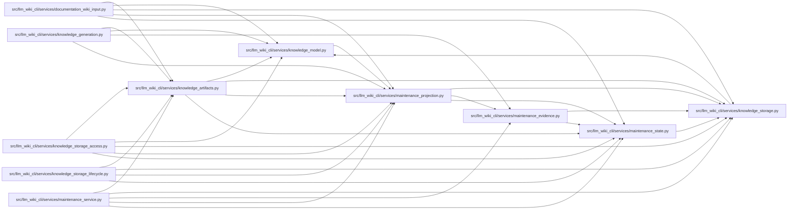

# maintenance_projection Module

**Path:** `src/llm_wiki_cli/services/maintenance_projection.py`

## Description

Bounded inspection projections of the separately owned maintenance ledger.

## Imports

| Source | Symbols |
|--------|---------|
| `.knowledge_storage` | `canonical_bytes` |
| `.maintenance_evidence` | `captured_semantic_sections` |
| `.maintenance_state` | `LIMITS`, `MaintenanceError`, `canonical_hash`, `maintenance_core`, `validate_maintenance_adoption`, `validate_maintenance_state`, `_identity` |
| `__future__` | `annotations` |
| `collections.abc` | `Mapping` |
| `copy` | `deepcopy` |
| `dataclasses` | `replace` |
| `re` | `re` |

## Local dependency map

<!-- Auto-generated local dependency summary. Do not edit by hand. -->

### Internal neighbors

| Direction | Module |
|---|---|
| Inbound | [documentation_wiki_input](../modules/documentation_wiki_input.md) |
| Inbound | [knowledge_artifacts](../modules/knowledge_artifacts.md) |
| Inbound | [knowledge_generation](../modules/knowledge_generation.md) |
| Inbound | [knowledge_model](../modules/knowledge_model.md) |
| Inbound | [knowledge_storage_access](../modules/knowledge_storage_access.md) |
| Inbound | [knowledge_storage_lifecycle](../modules/knowledge_storage_lifecycle.md) |
| Inbound | [maintenance_service](../modules/maintenance_service.md) |
| Outbound | [knowledge_storage](../modules/knowledge_storage.md) |
| Outbound | [maintenance_evidence](../modules/maintenance_evidence.md) |
| Outbound | [maintenance_state](../modules/maintenance_state.md) |

## Functions

| Function | Signature | Decorators | Description |
|----------|-----------|------------|-------------|
| `_fields` | `(value, fields, label)` | — | — |
| `validate_maintenance_binding` | `(value) -> dict` | — | — |
| `_parts` | `(concept)` | — | — |
| `validate_maintenance_concept_projection` | `(concept, *, binding, state = None) -> dict` | — | — |
| `project_maintenance_knowledge` | `(knowledge, state, marker)` | — | Derive root/concept projections; history remains exclusively in the owner. |
| `validate_maintenance_projection` | `(knowledge, state = None, marker = None, *, complete = True, raw_content_by_page = None) -> None` | — | — |
| `validate_maintenance_prose` | `(state, knowledge, raw_content_by_page, *, selected_paths = None) -> None` | — | Validate supplied exact pages; unavailable prose makes no byte claim. |
