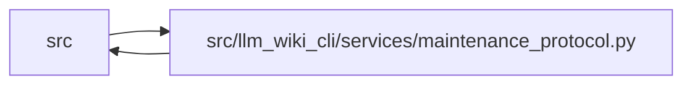

# maintenance_protocol Module

**Path:** `src/llm_wiki_cli/services/maintenance_protocol.py`

## Description

Immutable adoption detection and guarded maintenance publication basis.

## Imports

| Source | Symbols |
|--------|---------|
| `.bootstrap_recovery` | `guard_incomplete_bootstrap` |
| `.filesystem_guard` | `ensure_guarded_directory`, `atomic_write_guarded_bytes`, `unlink_guarded_bytes` |
| `.io` | `first_unsafe_path_component` |
| `.knowledge_governance` | `governance_lock`, `governance_lock`, `_governance_lock_root` |
| `.knowledge_storage` | `canonical_bytes`, `digest`, `MAX_EXPANDED_BYTES` |
| `.knowledge_storage_io` | `read_guarded`, `_absolute_path` |
| `.maintenance_state` | `validate_maintenance_adoption`, `maintenance_state_hash`, `validate_maintenance_state` |
| `.request_json` | `_pairs`, `_constant` |
| `.source_snapshot` | `SourceSnapshot`, `source_snapshot_matches_current_files` |
| `.sync_manifest` | `SyncManifest` |
| `.wiki_write_basis` | `ACTIVE_WRITE_BASIS`, `ACTIVE_WRITE_BASIS` |
| `__future__` | `annotations` |
| `asyncio` | `asyncio` |
| `collections.abc` | `Iterator` |
| `contextlib` | `contextmanager` |
| `contextvars` | `ContextVar` |
| `dataclasses` | `dataclass`, `field` |
| `json` | `json` |
| `os` | `os` |
| `pathlib` | `Path` |
| `threading` | `threading` |
| `typing` | `TYPE_CHECKING` |

## Local dependency map

<!-- Auto-generated local dependency summary. Do not edit by hand. -->

> Module-level dependencies exceed the generated-diagram limits, so the diagram and table below group them by top-level package. Counts report the number of module neighbors in each package.

### Internal neighbors

| Direction | Module |
|---|---|
| Inbound | `src` (17) |
| Outbound | `src` (11) |

> All 27 module neighbor(s) are summarized by package because the module-level view exceeds the 12-node limit.

## Classes

| Class | Line | Bases | Description |
|-------|------|-------|-------------|
| [MaintenanceProtocolError](../entities/MaintenanceProtocolError.md) | 30 | `ValueError` | — |
| [WikiWriteBasis](../entities/WikiWriteBasis.md) | 161 | — | — |

## Functions

| Function | Signature | Decorators | Description |
|----------|-----------|------------|-------------|
| `_identity` | `()` | — | — |
| `storage_writer_lock` | `(wiki_dir: str \| Path) -> Iterator[None]` | `@contextmanager` | Reuse only the same verified operation's non-reentrant storage lock. |
| `governance_writer_lock` | `(wiki_dir: str \| Path) -> Iterator[None]` | `@contextmanager` | — |
| `load_adoption_marker` | `(wiki_dir: str \| Path) -> dict \| None` | — | — |
| `guard_maintenance_owner` | `(wiki_dir: str \| Path, manifest = None)` | — | Never seed or repair an adopted wiki whose durable authority was lost. |
| `snapshot_wiki` | `(wiki_dir: str \| Path, *, include_transient: bool = False) -> dict[str, bytes]` | — | — |
| `save_recovery_snapshot` | `(directory: Path, files: dict[str, bytes], *, marker: dict \| None, kind = 'committed')` | — | — |
| `_recovery_directory` | `(root: Path, files: dict[str, bytes]) -> Path` | — | — |
| `maintenance_write_operation` | `(wiki_dir: str \| Path, *, dry_run = False, recovery_dir: Path \| None = None)` | `@contextmanager` | Hold locks from capture to publication; adopted writes retain preimages. |
| `unlink_maintenance_page` | `(path: Path) -> None` | — | Delete managed prose against the operation's captured exact preimage. |
