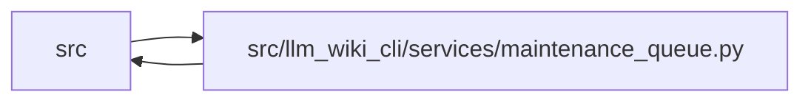

# maintenance_queue Module

**Path:** `src/llm_wiki_cli/services/maintenance_queue.py`

## Description

Ranks managed wiki pages using captured freshness, semantic work items, lint
findings, reachability, and source fan-in. Each bounded queue item explains its
priority, distinguishes actionable from informational evidence, and identifies
the editable semantic section. Unknown provenance stays explicit; queue
construction preserves the captured source/wiki basis and does not edit pages.

For a coherent unadopted native wiki, the same captured inventory and verified
page mappings identify source-backed semantic sections that lack ordinary review
custody. Their exact section locators appear as bounded informational coverage
gaps even after owning sync makes structural freshness current. This keeps
retained authored claims visible for source/prose inspection without inventing
pending records, acknowledgments or a verdict about their correctness. Corrected
prose remains untracked until explicit adoption and review.

## Imports

| Source | Symbols |
|--------|---------|
| `.context_packet_builder` | `capture_context_read`, `_assert_source_unchanged`, `_assert_wiki_unchanged`, `_assert_selection_unchanged` |
| `.documentation_worklist` | `build_documentation_worklist` |
| `.inventory_cache` | `InventoryCacheOptions` |
| `.lint_service` | `build_report` |
| `.maintenance_service` | `capture_maintenance_observations` |
| `__future__` | `annotations` |
| `collections` | `Counter` |
| `dataclasses` | `asdict` |
| `hashlib` | `hashlib` |
| `json` | `json` |
| `llm_wiki_engine.knowledge_storage` | `canonical_bytes`, `canonical_bytes` |
| `llm_wiki_engine.layout` | `DEFAULT_LAYOUT` |
| `llm_wiki_engine.maintenance_status` | `compact_maintenance_summary`, `build_maintenance_status` |
| `pathlib` | `Path` |

## Local dependency map

<!-- Auto-generated local dependency summary. Do not edit by hand. -->

> Module-level dependencies exceed the generated-diagram limits, so the diagram and table below group them by top-level package. Counts report the number of module neighbors in each package.

### Internal neighbors

| Direction | Module |
|---|---|
| Inbound | `src` (4) |
| Outbound | `src` (8) |

> All 12 module neighbor(s) are summarized by package because the module-level view exceeds the 12-node limit.

## Functions

| Function | Signature | Decorators | Description |
|----------|-----------|------------|-------------|
| `validate_queue_limit` | `(limit: object) -> int` | — | Validate the shared CLI and service bound before reading queue inputs. |
| `_ordinary_review_custody` | `(maintenance_report, manifest_basis)` | — | Qualify existing captured authority without another read or adoption. |
| `compose_queue` | `(pages, work_items, freshness, issues, metrics, *, limit = DEFAULT_QUEUE_LIMIT, maintenance_report = None, manifest_basis = None)` | — | Rank captured evidence; unknown provenance never becomes confirmed drift. |
| `build_maintenance_queue` | `(src_dir = '.', wiki_dir = DEFAULT_LAYOUT.wiki_dir, *, limit = DEFAULT_QUEUE_LIMIT, allow_external_src = False, source_selection = None, helper_cache_dir = None)` | — | — |
| `render_queue` | `(queue)` | — | — |
