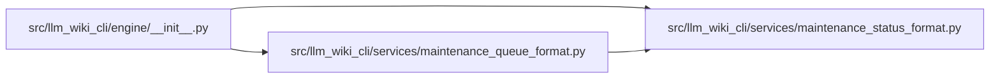

# maintenance_queue_format Module

**Path:** `src/llm_wiki_cli/services/maintenance_queue_format.py`

## Description

Published maintenance queue format: ``llm-wiki-maintenance-queue/v1``.

The queue is an advisory ranking of wiki pages that may need maintenance. The
format is additive, so consumers accept fields it does not list; the compact
maintenance summary and the source coordinates and semantic targets it embeds
keep their closed shapes. The checks here are the ones a JSON Schema cannot
express: counts add up, items are ranked by score and path and each score is
the sum of its reasons, an item's category and classification follow from its
evidence, coverage gaps and ordinary-review details count what they list,
review custody agrees with its evidence, an incompatible source selection
marks every item, and ``queue_id`` hashes the rest of the report.

## Imports

| Source | Symbols |
|--------|---------|
| `.maintenance_status_format` | `MaintenanceStatusError`, `check_coordinate`, `check_maintenance_summary`, `check_target` |
| `__future__` | `annotations` |
| `collections.abc` | `Mapping`, `Sequence` |
| `hashlib` | `hashlib` |
| `json` | `json` |
| `re` | `re` |
| `typing` | `Any` |

## Local dependency map

<!-- Auto-generated local dependency summary. Do not edit by hand. -->

### Internal neighbors

| Direction | Module |
|---|---|
| Inbound | [engine___init__](../modules/engine___init__.md) |
| Outbound | [maintenance_status_format](../modules/maintenance_status_format.md) |

## Classes

| Class | Line | Bases | Description |
|-------|------|-------|-------------|
| [MaintenanceQueueError](../entities/MaintenanceQueueError.md) | 122 | `ValueError` | A maintenance queue report does not satisfy its published format. |

## Functions

| Function | Signature | Decorators | Description |
|----------|-----------|------------|-------------|
| `validate_maintenance_queue` | `(document: object) -> None` | — | Raise ``MaintenanceQueueError`` unless ``document`` is a valid queue report. |
| `maintenance_queue_id` | `(report: Mapping[str, Any]) -> str` | — | The identity of a queue report: a hash of everything but ``queue_id``. |
| `_validate` | `(document: object) -> None` | — | — |
| `_check_counts` | `(queue: Mapping[str, Any], items: Sequence[Mapping[str, Any]]) -> None` | — | — |
| `_check_item` | `(value: object, field: str) -> None` | — | — |
| `_check_item_consistency` | `(item: Mapping[str, Any], field: str, reasons: Sequence[Any]) -> None` | — | — |
| `_check_coverage_gaps` | `(item: Mapping[str, Any], field: str) -> None` | — | — |
| `_check_ordinary_review` | `(item: Mapping[str, Any], field: str) -> None` | — | — |
| `_check_qualification` | `(value: object) -> None` | — | — |
| `_check_custody` | `(custody: Mapping[str, Any], field: str) -> None` | — | — |
| `_check_diagnostic` | `(value: object, field: str) -> None` | — | — |
| `_together` | `(item: Mapping[str, Any], fields: Sequence[str], field: str) -> bool` | — | — |
| `_bounds` | `(value: object, field: str, fields: Sequence[str], items: Sequence[Any]) -> Mapping[str, Any]` | — | — |
| `_budget` | `(bounds: Mapping[str, Any], field: str) -> None` | — | — |
| `_fields` | `(value: object, field: str, required: Sequence[str]) -> Mapping[str, Any]` | — | — |
| `_sequence` | `(value: object, field: str) -> Sequence[Any]` | — | — |
| `_choice` | `(value: object, field: str, choices: Sequence[str]) -> None` | — | — |
| `_string` | `(value: object, field: str) -> None` | — | — |
| `_text` | `(value: object, field: str) -> None` | — | — |
| `_optional_text` | `(value: object, field: str) -> None` | — | — |
| `_texts` | `(value: object, field: str) -> None` | — | — |
| `_hash` | `(value: object, field: str) -> None` | — | — |
| `_flag` | `(value: object, field: str) -> None` | — | — |
| `_integer` | `(value: object) -> bool` | — | — |
| `_count` | `(value: object, field: str) -> None` | — | — |
