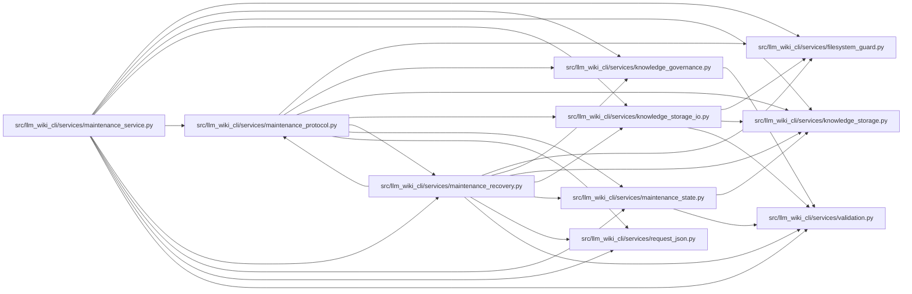

# maintenance_recovery Module

**Path:** `src/llm_wiki_cli/services/maintenance_recovery.py`

## Description

Complete maintenance recovery catalogs backed by immutable deduplicated bytes.

## Imports

| Source | Symbols |
|--------|---------|
| `.filesystem_guard` | `atomic_write_guarded_bytes`, `ensure_guarded_directory`, `fresh_no_follow_stat`, `remove_guarded_tree`, `unlink_guarded_bytes` |
| `.knowledge_governance` | `governance_lock` |
| `.knowledge_storage` | `MAX_EXPANDED_BYTES`, `canonical_bytes`, `digest` |
| `.knowledge_storage_io` | `_absolute_path`, `read_guarded` |
| `.maintenance_protocol` | `MaintenanceProtocolError` |
| `.maintenance_state` | `validate_maintenance_adoption`, `validate_maintenance_adoption` |
| `.request_json` | `_pairs`, `_constant` |
| `.validation` | `is_portable_relative_path` |
| `__future__` | `annotations` |
| `collections.abc` | `Mapping` |
| `contextlib` | `contextmanager` |
| `json` | `json` |
| `pathlib` | `Path` |
| `re` | `re` |
| `time` | `time` |

## Local dependency map

<!-- Auto-generated local dependency summary. Do not edit by hand. -->

### Internal neighbors

| Direction | Module |
|---|---|
| Inbound | [maintenance_protocol](../modules/maintenance_protocol.md) |
| Inbound | [maintenance_service](../modules/maintenance_service.md) |
| Outbound | [filesystem_guard](../modules/filesystem_guard.md) |
| Outbound | [knowledge_governance](../modules/knowledge_governance.md) |
| Outbound | [knowledge_storage](../modules/knowledge_storage.md) |
| Outbound | [knowledge_storage_io](../modules/knowledge_storage_io.md) |
| Outbound | [maintenance_protocol](../modules/maintenance_protocol.md) |
| Outbound | [maintenance_state](../modules/maintenance_state.md) |
| Outbound | [request_json](../modules/request_json.md) |
| Outbound | [validation](../modules/validation.md) |

## Functions

| Function | Signature | Decorators | Description |
|----------|-----------|------------|-------------|
| `_portable_name` | `(value)` | — | — |
| `_invalid` | `(message)` | — | — |
| `_owner` | `(owner_root, marker)` | — | — |
| `recovery_catalog_key` | `(owner_root, marker, file_hashes: Mapping[str, str]) -> str` | — | Bind managed directory identity to exact bytes and one wiki/adoption. |
| `_managed_store` | `(root: Path) -> Path \| None` | — | — |
| `_store_lock` | `(store)` | `@contextmanager` | — |
| `_blob_path` | `(root: Path, metadata, logical_hash: str) -> Path` | — | — |
| `_read_json` | `(path: Path, maximum = _MAX_CATALOG_BYTES)` | — | — |
| `_validate_catalog` | `(metadata)` | — | — |
| `_validate_layout` | `(root, metadata)` | — | — |
| `_immutable_write` | `(path: Path, raw: bytes) -> None` | — | — |
| `save_recovery_catalog` | `(directory, files: Mapping[str, bytes], *, marker, kind = 'committed', owner_root)` | — | Publish complete file commitments after all exact immutable blobs exist. |
| `_save_recovery_catalog` | `(root, files, *, marker, kind, owner_root)` | — | — |
| `load_recovery_catalog` | `(directory, metadata) -> dict[str, bytes]` | — | Verify complete exact bytes before the caller validates their semantics. |
| `_load_recovery_catalog` | `(root, metadata)` | — | — |
| `mark_recovery_complete` | `(preimage_directory, committed_directory) -> None` | — | Positively mark one successfully verified managed publication. |
| `_mark_recovery_complete` | `(preimage_directory, committed_directory)` | — | — |
| `retain_recovery_catalogs` | `(store, *, owner_root, marker, newest_committed, keep_successful = 2)` | — | Retire only positively completed catalogs in one exact owner namespace. |
| `_retain_recovery_catalogs` | `(root, *, owner_root, marker, newest_committed, keep_successful)` | — | — |
| `collect_recovery_blobs` | `(store)` | — | Collect verified unreachable blobs under the shared writer barrier. |
| `_shared_references` | `(root)` | — | — |
| `_collect_recovery_blobs` | `(root)` | — | — |
