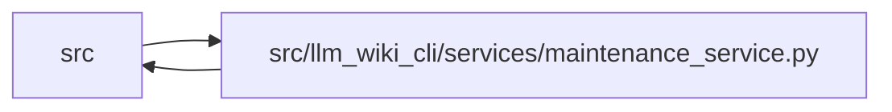

# maintenance_service Module

**Path:** `src/llm_wiki_cli/services/maintenance_service.py`

## Description

Local maintenance adoption and captured authority operations.

Explicit committed recovery validates the complete retained snapshot and derives generated ownership from the knowledge/surface roots and their exact referenced native storage objects, including indexed owner catalogs. With a surviving matching marker or current owner, absent files in that closure can be restored byte-for-byte without reconstructing identity or history. Backup inventory membership or a native-looking path alone grants no missing-file allowance.

Authored pages/assets, unreferenced files, changed existing bytes, another identity and known newer authority retain their refusal rules. Prepared and captured preimages keep their separate explicit modes. All eligibility checks precede guarded writes, and the manifest is published last. Recovery preserves source bytes and restores a snapshot rather than proving live currentness or approving prose. The public recovery-snapshot loader still returns metadata, files and owner; generated ownership stays private.

## Imports

| Source | Symbols |
|--------|---------|
| `.context_packet_builder` | `capture_context_read` |
| `.knowledge_orchestration` | `capture_committed_knowledge`, `capture_committed_knowledge` |
| `.knowledge_reuse` | `REUSE_INPUT_KEY`, `REUSE_EXTENSION_KEY`, `rebind_maintenance_reuse` |
| `.python_implementation` | `analysis_identity`, `analysis_identity` |
| `.source_snapshot` | `confirmed_missing_source_paths`, `source_snapshot_matches_current_files`, `build_source_snapshot`, `source_snapshot_matches_current_files` |
| `__future__` | `annotations` |
| `contextlib` | `contextmanager` |
| `copy` | `deepcopy` |
| `dataclasses` | `replace` |
| `json` | `json` |
| `llm_wiki_engine.filesystem_guard` | `ensure_guarded_directory`, `atomic_write_guarded_bytes`, `unlink_guarded_bytes` |
| `llm_wiki_engine.io` | `decode_markdown_bytes`, `decode_markdown_bytes` |
| `llm_wiki_engine.knowledge_artifacts` | `build_knowledge_commit_plan`, `commit_knowledge_artifacts`, `validated_artifact_bytes`, `validate_knowledge_artifacts`, `KnowledgeArtifactError` |
| `llm_wiki_engine.knowledge_envelope` | `hash_source_snapshot`, `ConsumedInput`, `is_valid_sha256`, `hash_markdown_snapshot`, `is_valid_sha256` |
| `llm_wiki_engine.knowledge_governance` | `GOVERNANCE_FILENAME`, `GOVERNANCE_FILENAME`, `parse_governance_ledger`, `validate_governance_projection` |
| `llm_wiki_engine.knowledge_storage` | `canonical_bytes`, `digest`, `MAX_EXPANDED_BYTES` |
| `llm_wiki_engine.knowledge_storage_io` | `read_guarded`, `_absolute_path` |
| `llm_wiki_engine.layout` | `DEFAULT_LAYOUT` |
| `llm_wiki_engine.maintenance_evidence` | `captured_observations_from_knowledge`, `reconcile_pending_maintenance`, `reconcile_pending_maintenance`, `owner_key` |
| `llm_wiki_engine.maintenance_projection` | `project_maintenance_knowledge`, `validate_maintenance_projection`, `project_maintenance_knowledge` |
| `llm_wiki_engine.maintenance_protocol` | `ADOPTION_FILENAME`, `MaintenanceProtocolError`, `WikiWriteBasis`, `governance_writer_lock`, `storage_writer_lock`, `guard_maintenance_owner`, `load_adoption_marker`, `snapshot_wiki`, `save_recovery_snapshot`, `maintenance_write_operation` |
| `llm_wiki_engine.maintenance_recovery` | `CATALOG_SCHEMA`, `load_recovery_catalog` |
| `llm_wiki_engine.maintenance_state` | `new_identity`, `validate_maintenance_adoption`, `maintenance_state_hash`, `_identity`, `maintenance_core`, `maintenance_state_hash`, `_identity` |
| `llm_wiki_engine.maintenance_status` | `build_maintenance_status`, `build_maintenance_status` |
| `llm_wiki_engine.request_json` | `_pairs`, `_constant`, `_pairs`, `_constant` |
| `llm_wiki_engine.sync_manifest` | `SyncManifest`, `MANIFEST_FILENAME`, `MANIFEST_FILENAME`, `SyncManifest`, `SyncManifest`, `SyncManifest`, `SyncManifest` |
| `llm_wiki_engine.validation` | `is_portable_relative_path`, `is_portable_relative_path` |
| `llm_wiki_engine.wiki_surface` | `collect_wiki_pages` |
| `llm_wiki_engine.wiki_write_basis` | `ACTIVE_WRITE_BASIS` |
| `pathlib` | `Path`, `Path` |

## Local dependency map

<!-- Auto-generated local dependency summary. Do not edit by hand. -->

> Module-level dependencies exceed the generated-diagram limits, so the diagram and table below group them by top-level package. Counts report the number of module neighbors in each package.

### Internal neighbors

| Direction | Module |
|---|---|
| Inbound | `src` (3) |
| Outbound | `src` (24) |

> All 27 module neighbor(s) are summarized by package because the module-level view exceeds the 12-node limit.

## Functions

| Function | Signature | Decorators | Description |
|----------|-----------|------------|-------------|
| `_capture` | `(src_dir, wiki_dir, *, require_ready = True, **options)` | — | — |
| `capture_maintenance_observations` | `(captured, state = None, *, raw_pages = None, knowledge = None, manifest = None)` | — | — |
| `_capture_basis` | `(root, files)` | `@contextmanager` | — |
| `_outside_recovery` | `(directory, root, source)` | — | — |
| `_validate_capture_roots` | `(captured, source, root)` | — | Compare guarded roots in the same canonical path namespace. |
| `adopt_maintenance_authority` | `(src_dir, wiki_dir, *, recovery_dir, manifest_format = None, fault_injector = None, _captured = None, **capture_options)` | — | Explicitly adopt durable unreviewed authority without editing Markdown. |
| `load_recovery_snapshot` | `(directory, *, allow_captured_preimage = False)` | — | — |
| `_validated_recovery_snapshot` | `(directory, *, allow_captured_preimage = False)` | — | Retain validator-proven storage ownership without changing the public tuple. |
| `_load_recovery_snapshot` | `(directory, *, allow_captured_preimage = False)` | — | — |
| `recover_maintenance_authority` | `(wiki_dir, *, recovery_dir, expected_adoption_id, allow_prepared_adoption = False, allow_captured_preimage = False, src_dir = None)` | — | Restore one validated complete snapshot; never reconstruct review history. |
| `_validate_status_request` | `(live, record_id, limit)` | — | — |
| `_native_prose_coherent` | `(root, knowledge, files)` | — | Check native normalized prose without treating ledger baselines as current. |
| `maintenance_report_from_captured` | `(captured, *, raw_pages = None, historical_knowledge = None, historical_manifest = None)` | — | Reuse one captured inventory; never extract again to decorate a read. |
| `get_maintenance_status_authority` | `(src_dir, wiki_dir, *, live = True, record_id = None, limit = 30, **capture_options)` | — | Read current ordinary-review needs without publishing observations/history. |
| `acknowledge_maintenance_authority` | `(src_dir, wiki_dir, *, record_id, expected_state_hash, expected_basis, actor_kind, actor_id, recovery_dir = None, **capture_options)` | — | Acknowledge one explicitly reviewed exact live basis under the writer locks. |
