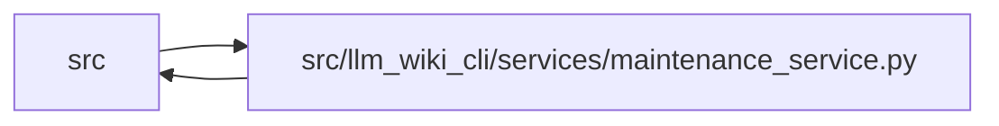

# maintenance_service Module

**Path:** `src/llm_wiki_cli/services/maintenance_service.py`

## Description

Local maintenance adoption and captured authority operations.

## Imports

| Source | Symbols |
|--------|---------|
| `.context_packet` | `capture_context_read` |
| `.filesystem_guard` | `ensure_guarded_directory`, `atomic_write_guarded_bytes`, `unlink_guarded_bytes` |
| `.io` | `decode_markdown_bytes`, `decode_markdown_bytes` |
| `.knowledge_artifacts` | `build_knowledge_commit_plan`, `commit_knowledge_artifacts`, `validated_artifact_bytes`, `validate_knowledge_artifacts`, `KnowledgeArtifactError` |
| `.knowledge_envelope` | `hash_source_snapshot`, `ConsumedInput`, `is_valid_sha256`, `hash_markdown_snapshot`, `is_valid_sha256` |
| `.knowledge_governance` | `GOVERNANCE_FILENAME`, `GOVERNANCE_FILENAME`, `parse_governance_ledger`, `validate_governance_projection` |
| `.knowledge_orchestration` | `capture_committed_knowledge`, `capture_committed_knowledge` |
| `.knowledge_reuse` | `REUSE_INPUT_KEY`, `REUSE_EXTENSION_KEY` |
| `.knowledge_storage` | `canonical_bytes`, `digest`, `MAX_EXPANDED_BYTES` |
| `.knowledge_storage_io` | `read_guarded`, `_absolute_path` |
| `.maintenance_evidence` | `captured_observations_from_knowledge`, `reconcile_pending_maintenance`, `reconcile_pending_maintenance`, `owner_key` |
| `.maintenance_projection` | `project_maintenance_knowledge`, `validate_maintenance_projection`, `project_maintenance_knowledge` |
| `.maintenance_protocol` | `ADOPTION_FILENAME`, `MaintenanceProtocolError`, `WikiWriteBasis`, `governance_writer_lock`, `storage_writer_lock`, `guard_maintenance_owner`, `load_adoption_marker`, `snapshot_wiki`, `save_recovery_snapshot`, `maintenance_write_operation` |
| `.maintenance_state` | `new_identity`, `validate_maintenance_adoption`, `maintenance_state_hash`, `_identity`, `maintenance_core`, `maintenance_state_hash`, `_identity` |
| `.maintenance_status` | `build_maintenance_status`, `build_maintenance_status` |
| `.python_implementation` | `analysis_identity`, `analysis_identity` |
| `.request_json` | `_pairs`, `_constant`, `_pairs`, `_constant` |
| `.source_snapshot` | `confirmed_missing_source_paths`, `source_snapshot_matches_current_files`, `build_source_snapshot`, `source_snapshot_matches_current_files` |
| `.sync_manifest` | `SyncManifest`, `MANIFEST_FILENAME`, `MANIFEST_FILENAME`, `SyncManifest`, `SyncManifest`, `SyncManifest`, `SyncManifest` |
| `.validation` | `is_portable_relative_path`, `is_portable_relative_path` |
| `.wiki_surface` | `collect_wiki_pages` |
| `.wiki_write_basis` | `ACTIVE_WRITE_BASIS` |
| `__future__` | `annotations` |
| `contextlib` | `contextmanager` |
| `copy` | `deepcopy` |
| `dataclasses` | `replace` |
| `json` | `json` |
| `pathlib` | `Path`, `Path` |

## Local dependency map

<!-- Auto-generated local dependency summary. Do not edit by hand. -->

> Module-level dependencies exceed the generated-diagram limits, so the diagram and table below group them by top-level package. Counts report the number of module neighbors in each package.

### Internal neighbors

| Direction | Module |
|---|---|
| Inbound | `src` (2) |
| Outbound | `src` (22) |

> All 23 module neighbor(s) are summarized by package because the module-level view exceeds the 12-node limit.

## Functions

| Function | Signature | Decorators | Description |
|----------|-----------|------------|-------------|
| `_capture` | `(src_dir, wiki_dir, *, require_ready = True, **options)` | — | — |
| `capture_maintenance_observations` | `(captured, state = None, *, raw_pages = None, knowledge = None, manifest = None)` | — | — |
| `_capture_basis` | `(root, files)` | `@contextmanager` | — |
| `_outside_recovery` | `(directory, root, source)` | — | — |
| `adopt_maintenance_authority` | `(src_dir, wiki_dir, *, recovery_dir, manifest_format = None, fault_injector = None, **capture_options)` | — | Explicitly adopt durable unreviewed authority without editing Markdown. |
| `load_recovery_snapshot` | `(directory, *, allow_captured_preimage = False)` | — | — |
| `_load_recovery_snapshot` | `(directory, *, allow_captured_preimage = False)` | — | — |
| `recover_maintenance_authority` | `(wiki_dir, *, recovery_dir, expected_adoption_id, allow_prepared_adoption = False, allow_captured_preimage = False, src_dir = None)` | — | Restore one validated complete snapshot; never reconstruct review history. |
| `_validate_status_request` | `(live, record_id, limit)` | — | — |
| `_native_prose_coherent` | `(root, knowledge, files)` | — | Check native normalized prose without treating ledger baselines as current. |
| `maintenance_report_from_captured` | `(captured, *, raw_pages = None, historical_knowledge = None, historical_manifest = None)` | — | Reuse one captured inventory; never extract again to decorate a read. |
| `get_maintenance_status_authority` | `(src_dir, wiki_dir, *, live = True, record_id = None, limit = 30, **capture_options)` | — | Read current ordinary-review needs without publishing observations/history. |
| `acknowledge_maintenance_authority` | `(src_dir, wiki_dir, *, record_id, expected_state_hash, expected_basis, actor_kind, actor_id, recovery_dir = None, **capture_options)` | — | Acknowledge one explicitly reviewed exact live basis under the writer locks. |
