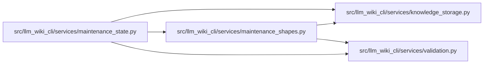

# maintenance_shapes Module

**Path:** `src/llm_wiki_cli/services/maintenance_shapes.py`

## Description

Strict maintenance payload shapes without a JSON Schema runtime dependency.

## Imports

| Source | Symbols |
|--------|---------|
| `.knowledge_storage` | `canonical_bytes`, `digest` |
| `.validation` | `require_exact_fields` |
| `__future__` | `annotations` |
| `re` | `re` |

## Local dependency map

<!-- Auto-generated local dependency summary. Do not edit by hand. -->

### Internal neighbors

| Direction | Module |
|---|---|
| Inbound | [maintenance_state](../modules/maintenance_state.md) |
| Outbound | [knowledge_storage](../modules/knowledge_storage.md) |
| Outbound | [validation](../modules/validation.md) |

## Classes

| Class | Line | Bases | Description |
|-------|------|-------|-------------|
| [MaintenanceError](../entities/maintenance_shapes_MaintenanceError.md) | 17 | `ValueError` | — |

## Functions

| Function | Signature | Decorators | Description |
|----------|-----------|------------|-------------|
| `canonical_hash` | `(value)` | — | — |
| `_shape_fields` | `(value, **kwargs)` | — | — |
| `require` | `(condition, code, message)` | — | — |
| `shape_1` | `(value, path)` | — | — |
| `shape_3` | `(value, path)` | — | — |
| `shape_2` | `(value, path)` | — | — |
| `shape_4` | `(value, path)` | — | — |
| `shape_5` | `(value, path)` | — | — |
| `shape_0` | `(value, path)` | — | — |
| `shape_7` | `(value, path)` | — | — |
| `shape_9` | `(value, path)` | — | — |
| `shape_10` | `(value, path)` | — | — |
| `shape_8` | `(value, path)` | — | — |
| `shape_12` | `(value, path)` | — | — |
| `shape_11` | `(value, path)` | — | — |
| `shape_13` | `(value, path)` | — | — |
| `shape_15` | `(value, path)` | — | — |
| `shape_14` | `(value, path)` | — | — |
| `shape_6` | `(value, path)` | — | — |
| `shape_17` | `(value, path)` | — | — |
| `shape_18` | `(value, path)` | — | — |
| `shape_23` | `(value, path)` | — | — |
| `shape_24` | `(value, path)` | — | — |
| `shape_22` | `(value, path)` | — | — |
| `shape_26` | `(value, path)` | — | — |
| `shape_27` | `(value, path)` | — | — |
| `shape_25` | `(value, path)` | — | — |
| `shape_28` | `(value, path)` | — | — |
| `shape_29` | `(value, path)` | — | — |
| `shape_30` | `(value, path)` | — | — |
| `shape_21` | `(value, path)` | — | — |
| `shape_31` | `(value, path)` | — | — |
| `shape_32` | `(value, path)` | — | — |
| `shape_20` | `(value, path)` | — | — |
| `shape_19` | `(value, path)` | — | — |
| `shape_38` | `(value, path)` | — | — |
| `shape_39` | `(value, path)` | — | — |
| `shape_40` | `(value, path)` | — | — |
| `shape_37` | `(value, path)` | — | — |
| `shape_41` | `(value, path)` | — | — |
| `shape_36` | `(value, path)` | — | — |
| `shape_35` | `(value, path)` | — | — |
| `shape_42` | `(value, path)` | — | — |
| `shape_45` | `(value, path)` | — | — |
| `shape_44` | `(value, path)` | — | — |
| `shape_46` | `(value, path)` | — | — |
| `shape_47` | `(value, path)` | — | — |
| `shape_48` | `(value, path)` | — | — |
| `shape_43` | `(value, path)` | — | — |
| `shape_49` | `(value, path)` | — | — |
| `shape_50` | `(value, path)` | — | — |
| `shape_51` | `(value, path)` | — | — |
| `shape_34` | `(value, path)` | — | — |
| `shape_33` | `(value, path)` | — | — |
| `shape_52` | `(value, path)` | — | — |
| `shape_16` | `(value, path)` | — | — |
| `shape_54` | `(value, path)` | — | — |
| `shape_55` | `(value, path)` | — | — |
| `shape_56` | `(value, path)` | — | — |
| `shape_57` | `(value, path)` | — | — |
| `shape_53` | `(value, path)` | — | — |
