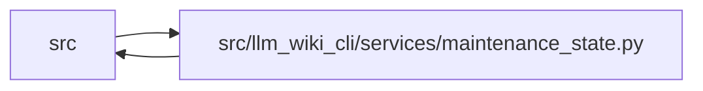

# maintenance_state Module

**Path:** `src/llm_wiki_cli/services/maintenance_state.py`

## Description

Pure durable maintenance authority and explicit source/prose review transitions.

All inputs come from a caller-owned captured basis. This service performs no
filesystem I/O, parsing, generation, storage adoption, or human governance
mutation. The operation owner supplies the implementation validator and holds
the shared writer lock around capture and manifest-last publication.

## Imports

| Source | Symbols |
|--------|---------|
| `.implementation_evidence` | `validate_implementation_evidence` |
| `.knowledge_storage` | `canonical_bytes`, `digest` |
| `.maintenance_shapes` | `MaintenanceError`, `VALIDATORS`, `require` |
| `.validation` | `require_repository_relative_path` |
| `__future__` | `annotations` |
| `collections.abc` | `Callable` |
| `copy` | `deepcopy` |
| `re` | `re` |
| `typing` | `Any` |
| `urllib.parse` | `quote`, `unquote` |
| `uuid` | `UUID`, `uuid4` |

## Local dependency map

<!-- Auto-generated local dependency summary. Do not edit by hand. -->

> Module-level dependencies exceed the generated-diagram limits, so the diagram and table below group them by top-level package. Counts report the number of module neighbors in each package.

### Internal neighbors

| Direction | Module |
|---|---|
| Inbound | `src` (11) |
| Outbound | `src` (4) |

> All 15 module neighbor(s) are summarized by package because the module-level view exceeds the 12-node limit.

## Classes

| Class | Line | Bases | Description |
|-------|------|-------|-------------|
| [MaintenanceCore](../entities/MaintenanceCore.md) | 111 | — | Pure transitions with the installed implementation contract as authority. |

## Functions

| Function | Signature | Decorators | Description |
|----------|-----------|------------|-------------|
| `canonical_hash` | `(value: object) -> str` | — | Canonical maintenance commitments include the storage protocol LF. |
| `new_identity` | `() -> str` | — | Allocate once in the operation owner; persist and replay this identity. |
| `_identity` | `(value: str) -> None` | — | — |
| `_portable` | `(value: Any, field: str) -> str` | — | — |
| `_finite` | `(value: Any, depth: int = 0, active: set[int] \| None = None) -> None` | — | — |
| `maintenance_core` | `() -> MaintenanceCore` | — | Use the installed implementation contract, never a model-only callback. |
| `_detached` | `(value: object) -> dict[str, Any]` | — | — |
| `validate_maintenance_state` | `(value: object) -> dict[str, Any]` | — | — |
| `validate_maintenance_adoption` | `(value: object) -> dict[str, Any]` | — | — |
| `maintenance_state_hash` | `(value: object) -> str` | — | — |
