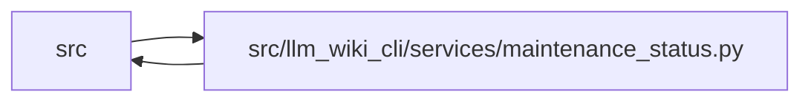

# maintenance_status Module

**Path:** `src/llm_wiki_cli/services/maintenance_status.py`

## Description

Immutable read-only ordinary maintenance reports from one captured basis.

## Imports

| Source | Symbols |
|--------|---------|
| `.extraction_service` | `InventoryResult` |
| `.immutable` | `freeze` |
| `.implementation_evidence` | `compare_implementation_observations` |
| `.knowledge_storage` | `canonical_bytes` |
| `.maintenance_evidence` | `MaintenanceCapture`, `owner_key`, `captured_observations_from_knowledge` |
| `.maintenance_service` | `maintenance_report_from_captured` |
| `.maintenance_state` | `canonical_hash`, `validate_maintenance_adoption`, `validate_maintenance_state` |
| `.python_implementation` | `analysis_identity` |
| `.source_snapshot` | `confirmed_missing_source_paths` |
| `__future__` | `annotations` |
| `collections.abc` | `Mapping` |
| `copy` | `deepcopy` |
| `dataclasses` | `dataclass`, `replace`, `replace` |
| `re` | `re` |
| `typing` | `Any` |

## Local dependency map

<!-- Auto-generated local dependency summary. Do not edit by hand. -->

> Module-level dependencies exceed the generated-diagram limits, so the diagram and table below group them by top-level package. Counts report the number of module neighbors in each package.

### Internal neighbors

| Direction | Module |
|---|---|
| Inbound | `src` (7) |
| Outbound | `src` (9) |

> All 15 module neighbor(s) are summarized by package because the module-level view exceeds the 12-node limit.

## Classes

| Class | Line | Bases | Description |
|-------|------|-------|-------------|
| [MaintenanceStatusReport](../entities/MaintenanceStatusReport.md) | 87 | — | — |

## Functions

| Function | Signature | Decorators | Description |
|----------|-----------|------------|-------------|
| `_limit` | `(value)` | — | — |
| `_history` | `(row, count)` | — | — |
| `_trim_coverage` | `(result)` | — | Auxiliary details yield to existing record and basis observations. |
| `_source_location` | `(coordinate, scope, envelope)` | — | — |
| `build_maintenance_status` | `(state, marker, capture: MaintenanceCapture \| None = None, *, implementation_observations = None, analysis_scope = 'snapshot', native_prose_coherent = True, coverage = None, analysis_compatibility_hash = None) -> MaintenanceStatusReport` | — | Project existing records only; no transition, allocation or storage writes. |
| `compact_maintenance_summary` | `(value) -> dict` | — | No coordinates, hashes, actor history or prose enter curated context. |
| `_summary` | `(payload, rows, *, truncated = False, untracked = 0)` | — | — |
| `validate_maintenance_summary` | `(value) -> dict` | — | — |
| `marker_from_validated_state` | `(state) -> dict` | — | Reconstruct fixed v1 fields and verify the immutable commitment. |
| `snapshot_report_for_view` | `(view) -> MaintenanceStatusReport \| None` | — | — |
| `attach_maintenance_status` | `(captured, *, live = True, analysis_scope = None, native_prose_coherent = True)` | — | Reuse captured source; historical native gaps stay separately disclosed. |
| `attach_maintenance_view_from_inputs` | `(view, inventory_result, *, content_by_page, raw_content_by_page, analysis_scope)` | — | Join existing guarded query inputs without extracting source again. |
