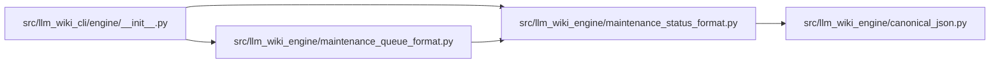

# maintenance_status_format Module

**Path:** `src/llm_wiki_engine/maintenance_status_format.py`

## Description

Published maintenance status format: ``llm-wiki-maintenance-status/v1``.

A status payload is one bounded read of ordinary review: the recorded review
state of each maintenance record and, when source was captured, its current
effective state. The format is closed. The checks here are the ones a JSON
Schema cannot express: availability and evaluation agree with the analysis
scope, every bound counts what it bounds, records are ordered and unique, each
record's qualification follows from what was evaluated, and an embedded
per-path summary agrees with the records it summarizes.

## Imports

| Source | Symbols |
|--------|---------|
| `.canonical_json` | `compact_line_bytes` |
| `__future__` | `annotations` |
| `collections.abc` | `Mapping`, `Sequence` |
| `re` | `re` |
| `typing` | `Any` |

## Local dependency map

<!-- Auto-generated local dependency summary. Do not edit by hand. -->

### Internal neighbors

| Direction | Module |
|---|---|
| Inbound | [engine___init__](../modules/engine___init__.md) |
| Inbound | [maintenance_queue_format](../modules/maintenance_queue_format.md) |
| Outbound | [canonical_json](../modules/canonical_json.md) |

## Classes

| Class | Line | Bases | Description |
|-------|------|-------|-------------|
| [MaintenanceStatusError](../entities/MaintenanceStatusError.md) | 141 | `ValueError` | A maintenance status payload does not satisfy its published format. |

## Functions

| Function | Signature | Decorators | Description |
|----------|-----------|------------|-------------|
| `validate_maintenance_status` | `(document: object) -> None` | — | Raise ``MaintenanceStatusError`` unless ``document`` is a valid status payload. |
| `_check_qualification` | `(status: Mapping[str, Any]) -> None` | — | — |
| `_check_coverage` | `(value: object) -> None` | — | — |
| `_list_bounds` | `(value: object, field: str, items: Sequence[Any]) -> None` | — | — |
| `_check_bounds` | `(value: object, records: Sequence[Any]) -> None` | — | — |
| `_check_record` | `(value: object, field: str, live: bool) -> None` | — | — |
| `_check_record_consistency` | `(record: Mapping[str, Any], field: str, live: bool) -> None` | — | — |
| `_history_bounds` | `(value: object, field: str, history: Sequence[Any]) -> None` | — | — |
| `_source_location` | `(value: object, field: str, coordinate: Mapping[str, Any]) -> None` | — | — |
| `check_maintenance_summary` | `(value: object, field: str = 'summary') -> Mapping[str, Any]` | — | Check a compact maintenance summary on its own and return it. |
| `_check_summary` | `(value: object, status: Mapping[str, Any]) -> None` | — | — |
| `_summary_counts` | `(records: Sequence[Mapping[str, Any]]) -> dict[str, int]` | — | — |
| `_issue` | `(value: object, field: str) -> None` | — | — |
| `check_coordinate` | `(value: object, field: str = 'coordinate') -> None` | — | Check a maintenance source coordinate. |
| `check_target` | `(value: object, field: str = 'target') -> None` | — | Check a maintenance semantic target. |
| `_coordinate` | `(value: object, field: str) -> None` | — | — |
| `_target` | `(value: object, field: str) -> None` | — | — |
| `_mapping` | `(value: object, field: str) -> None` | — | — |
| `_basis` | `(value: object, field: str) -> None` | — | — |
| `_acknowledgment` | `(value: object, field: str, record_id: str) -> None` | — | — |
| `_reasons` | `(value: object, field: str) -> None` | — | — |
| `_fields` | `(value: object, field: str, required: Sequence[str], optional: Sequence[str] = ()) -> Mapping[str, Any]` | — | — |
| `_sequence` | `(value: object, field: str) -> Sequence[Any]` | — | — |
| `_choice` | `(value: object, field: str, choices: Sequence[str]) -> None` | — | — |
| `_text` | `(value: object, field: str, limit: int) -> None` | — | — |
| `_identifier` | `(value: object, field: str) -> None` | — | — |
| `_record_id` | `(value: object, field: str) -> None` | — | — |
| `_hash` | `(value: object, field: str) -> None` | — | — |
| `_flag` | `(value: object, field: str) -> None` | — | — |
| `_integer` | `(value: object) -> bool` | — | — |
| `_count` | `(value: object, field: str) -> None` | — | — |
