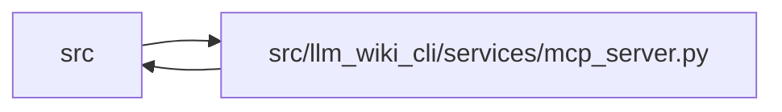

# mcp_server Module

**Path:** `src/llm_wiki_cli/services/mcp_server.py`

## Description

Exposes canonical wiki resources plus bounded search, graph, context, health,
and concept queries through a read-only service. `McpWikiService` resolves
pages and enforces the live source-selection pin without importing the optional
SDK, while server construction registers tools and resources only after the
runtime is available. HTTP transport is restricted to loopback and applies
origin validation; stdio remains the default.

Qualified packet calls leave omitted protocol selection to the library, matching
the API's current native-knowledge packet and automatic availability disclosure.
Plain context responses retain their separate compatibility contract. Packet
revalidation still rebuilds the current basis before reporting an unchanged ID.

## Imports

| Source | Symbols |
|--------|---------|
| `.` | `context_service`, `lint_service` |
| `..` | `api` |
| `..api` | `LlmWikiApiError`, `build_documentation_query_service`, `query_documentation` |
| `..api_types` | `KnowledgeMode` |
| `..config` | `IDE_AGENTS`, `PathValidationError`, `get_agent_config_path`, `read_config`, `validate_path`, `validate_source_root` |
| `.bootstrap_runtime` | `build_module_page_map` |
| `.context_budget` | `validate_request` |
| `.context_packet_builder` | `describe_context_packet_error`, `build_qualified_context`, `describe_context_packet_error` |
| `.documentation_queries` | `DocumentationQueryError` |
| `.documentation_query_builder` | `validate_live_query_source_selection` |
| `.extraction_service` | `InventoryRequest`, `get_inventory_result` |
| `.helper_runtime` | `helper_operation` |
| `.legacy_hooks` | `LegacyHookError`, `inspect_legacy_hooks` |
| `.maintenance_queue` | `validate_queue_limit` |
| `.source_snapshot` | `SourceSnapshot`, `build_source_snapshot`, `capture_source_selection_inputs` |
| `.task_context` | `_counter` |
| `.token_counting` | `TokenCounter`, `LocalTokenizerCounter` |
| `__future__` | `annotations` |
| `collections.abc` | `Callable`, `Iterable`, `Mapping` |
| `contextlib` | `asynccontextmanager` |
| `dataclasses` | `dataclass`, `field` |
| `functools` | `wraps` |
| `ipaddress` | `ipaddress` |
| `itertools` | `islice` |
| `json` | `json` |
| `llm_wiki_engine` | `analysis_compatibility`, `circuit_breaker`, `wiki_surface` |
| `llm_wiki_engine.concept_identity` | `ConceptIdentityError`, `validate_concept_uid`, `validate_natural_key` |
| `llm_wiki_engine.context_knowledge_contract` | `KNOWLEDGE_MODE_REQUEST_FIELD`, `KNOWLEDGE_MODE_VALUES`, `RESERVED_CONTEXT_KNOWLEDGE_PROTOCOL_VERSION` |
| `llm_wiki_engine.context_packet` | `ContextPacketError` |
| `llm_wiki_engine.io` | `read_md` |
| `llm_wiki_engine.knowledge_graph` | `CORE_RELATIONSHIP_KINDS`, `GRAPH_ORIGINS`, `GRAPH_RESOLUTIONS` |
| `llm_wiki_engine.knowledge_observability` | `knowledge_status_payload`, `load_snapshot_knowledge_observability` |
| `llm_wiki_engine.request_json` | `MAX_REQUEST_BYTES` |
| `llm_wiki_engine.search_discovery` | `DiscoveryError`, `MAX_DISCOVERY_BYTES` |
| `llm_wiki_engine.search_service` | `normalize_discovery`, `normalize_search`, `search_prevalidated_roots` |
| `llm_wiki_engine.source_selection` | `SourceSelectionError`, `SourceSelectionPolicy`, `resolve_source_selection` |
| `llm_wiki_engine.task_compact_readable` | `readable_session_metadata` |
| `llm_wiki_engine.task_contract` | `normalize_task_request` |
| `llm_wiki_engine.validation` | `posix_path_text`, `require_portable_relative_path` |
| `llm_wiki_engine.workflow_profile` | `WorkflowPolicy`, `WorkflowProfile`, `canonical_json`, `canonical_json` |
| `mcp` | `mcp` |
| `mcp.server.fastmcp` | `FastMCP` |
| `mcp.types` | `CallToolResult`, `TextContent`, `CallToolResult`, `TextContent`, `CallToolResult`, `TextContent`, `CallToolResult`, `TextContent`, `CallToolResult`, `TextContent`, `CallToolResult`, `TextContent` |
| `pathlib` | `Path` |
| `pydantic` | `StrictBool`, `StrictInt` |
| `re` | `re` |
| `secrets` | `secrets` |
| `sys` | `sys` |
| `typing` | `Any`, `Protocol`, `TypedDict`, `cast` |
| `urllib.parse` | `unquote`, `urlparse` |
| `uvicorn` | `uvicorn` |

## Local dependency map

<!-- Auto-generated local dependency summary. Do not edit by hand. -->

> Module-level dependencies exceed the generated-diagram limits, so the diagram and table below group them by top-level package. Counts report the number of module neighbors in each package.

### Internal neighbors

| Direction | Module |
|---|---|
| Inbound | `src` (1) |
| Outbound | `src` (34) |

### External packages

| Language | Used packages | Undeclared packages |
|---|---:|---:|
| python | 3 | 0 |

> All 35 module neighbor(s) are summarized by package because the module-level view exceeds the 12-node limit.

## Classes

| Class | Line | Bases | Description |
|-------|------|-------|-------------|
| [MCPDependencyError](../entities/MCPDependencyError.md) | 120 | `RuntimeError` | Raised when the optional MCP runtime cannot be used. |
| [McpWikiError](../entities/McpWikiError.md) | 124 | `ValueError` | Raised for invalid MCP wiki requests. |
| [_SourceSelectionOptions](../entities/SourceSelectionOptions.md) | 221 | `TypedDict` | — |
| [_ExternalSourceOptions](../entities/ExternalSourceOptions.md) | 225 | `TypedDict` | — |
| [_McpHttpApplication](../entities/McpHttpApplication.md) | 229 | `Protocol` | — |
| [_RunnableMcpServer](../entities/RunnableMcpServer.md) | 237 | `Protocol` | — |
| [McpServerConfig](../entities/McpServerConfig.md) | 244 | — | — |
| [_SourceSelectionPin](../entities/SourceSelectionPin.md) | 266 | — | — |
| [WikiPage](../entities/mcp_server_WikiPage.md) | 285 | — | — |
| [OriginValidationMiddleware](../entities/OriginValidationMiddleware.md) | 372 | — | Minimal ASGI middleware that rejects unexpected browser origins. |
| [McpWikiService](../entities/McpWikiService.md) | 436 | — | Workspace read/check operations with managed helper provisioning. |

## Functions

| Function | Signature | Decorators | Description |
|----------|-----------|------------|-------------|
| `_normalize_knowledge_mode` | `(value: object) -> KnowledgeMode \| None` | — | — |
| `_required_knowledge_mcp_error` | `(exc: BaseException) -> McpWikiError` | — | — |
| `_is_required_knowledge_failure` | `(exc: BaseException) -> bool` | — | — |
| `_api_mcp_error` | `(exc: LlmWikiApiError) -> McpWikiError` | — | — |
| `_path_validation_mcp_error` | `(exc: PathValidationError) -> McpWikiError` | — | — |
| `_wiki_surface_path_mcp_error` | `(exc: wiki_surface.WikiSurfacePathError) -> McpWikiError` | — | — |
| `_wiki_surface_path_data` | `(exc: BaseException) -> dict[str, Any] \| None` | — | — |
| `_source_selection_pin` | `(policy: SourceSelectionPolicy \| None) -> _SourceSelectionPin` | — | — |
| `ensure_mcp_runtime` | `() -> None` | — | Validate that the optional MCP SDK can be imported on this runtime. |
| `validate_loopback_host` | `(host: str) -> None` | — | Reject non-loopback HTTP binds for local-only MCP v1. |
| `_is_loopback_host` | `(host: str) -> bool` | — | — |
| `_default_port_for_scheme` | `(scheme: str) -> int \| None` | — | — |
| `_normalise_origin` | `(origin: str) -> str` | — | — |
| `is_origin_allowed` | `(origin: str, *, port: int, allowed_origins: list[str] \| tuple[str, ...]) -> bool` | — | Return True when an HTTP Origin is acceptable for local MCP use. |
| `_bound_operation` | `(function)` | — | Give each MCP call a fresh helper binding and its comparison policy. |
| `create_mcp_server` | `(config: McpServerConfig)` | — | Create and register the FastMCP server for a validated config. |
| `_native_tool_call` | `(callback: Callable[..., Any], *args, **kwargs) -> Any` | — | Preserve semantic native failures through the optional SDK transport. |
| `_register_mcp_tools` | `(server, service: McpWikiService) -> None` | — | — |
| `_register_mcp_resources` | `(server, service: McpWikiService) -> None` | — | — |
| `_register_root_resource` | `(server, service: McpWikiService, entry) -> None` | — | — |
| `_register_directory_resource` | `(server, service: McpWikiService, entry) -> None` | — | — |
| `run_mcp_server` | `(config: McpServerConfig) -> None` | — | Validate, build, and run the MCP server. |
| `_resource_uri` | `(kind: str, page_id: str) -> str` | — | — |
| `_graph_query_args` | `(query: Mapping[str, object]) -> tuple[str, str, int]` | — | — |
| `_knowledge_locator` | `(value: object) -> str` | — | — |
| `_knowledge_direction` | `(value: object) -> str` | — | — |
| `_section_ownership` | `(value: object) -> str \| None` | — | — |
| `_bounded_query_filter_values` | `(values: object, *, field: str, item_description: str) -> list[str]` | — | — |
| `_knowledge_kinds` | `(values: object) -> list[str] \| None` | — | — |
| `_typed_graph_direction` | `(value: object) -> str` | — | — |
| `_typed_graph_kinds` | `(values: object) -> list[str] \| None` | — | — |
| `_typed_graph_enum_values` | `(values: object, *, field: str, allowed: tuple[str, ...]) -> list[str] \| None` | — | — |
| `_bounded_query_limit` | `(value: object) -> int` | — | — |
| `_validate_page_id` | `(page_id: str) -> str` | — | — |
| `_is_safe_page_id` | `(page_id: str) -> bool` | — | — |
| `_normalise_source_path` | `(path: str) -> str` | — | — |
| `_ensure_inside` | `(root: Path, path: Path) -> None` | — | Retain the legacy lexical helper for callers outside page reads. |
| `_relative_posix` | `(path: Path, root: Path) -> str` | — | — |
| `_posix_string` | `(value: object) -> str` | — | — |
| `_normalise_report_paths` | `(payload: dict) -> None` | — | — |
| `_markdown_title` | `(content: str, fallback: str) -> str` | — | — |
| `_snippet` | `(content: str, start: int, length: int) -> str` | — | — |
| `_count_md` | `(path: Path) -> int` | — | — |
| `_count_surface_pages` | `(path: Path, entry) -> int` | — | — |
| `_installed_hooks` | `() -> list[str]` | — | Preserve the status field while reporting only verified legacy residue. |
| `to_json` | `(data: object) -> str` | — | Serialize data as stable, human-readable JSON. |
