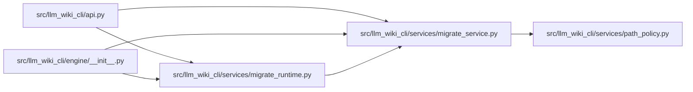

# migrate_service Module

**Path:** `src/llm_wiki_cli/services/migrate_service.py`

## Description

Typed migrate inputs and results shared by the CLI, the Python API and engines.

Importing this module is cheap; the migration lives in
:mod:`llm_wiki_cli.services.migrate_runtime` and is loaded on first use.

## Imports

| Source | Symbols |
|--------|---------|
| `.path_policy` | `DEFAULT_WIKI_DIR` |
| `__future__` | `annotations` |
| `dataclasses` | `dataclass` |
| `pathlib` | `Path` |
| `typing` | `Any`, `Literal` |

## Local dependency map

<!-- Auto-generated local dependency summary. Do not edit by hand. -->

### Internal neighbors

| Direction | Module |
|---|---|
| Inbound | [api](../modules/api.md) |
| Inbound | [engine___init__](../modules/engine___init__.md) |
| Inbound | [migrate_runtime](../modules/migrate_runtime.md) |
| Outbound | [path_policy](../modules/path_policy.md) |

## Classes

| Class | Kind | Line | Bases / Target | Description |
|-------|------|------|----------------|-------------|
| [MigrateStatus](../entities/MigrateStatus.md) | Type alias | 15 | `Literal['migrated', 'planned', 'chunk-applied', 'up-to-date']` | — |
| [MigrateRequest](../entities/MigrateRequest.md) | Class | 19 | — | One migration of a wiki written by an older llm-wiki to current naming. |
| [MigrateOutcome](../entities/MigrateOutcome.md) | Class | 40 | — | What one migration did; human-readable progress went to the host streams. |
| [MigrateError](../entities/MigrateError.md) | Class | 71 | `Exception` | Migration stopped; ``exit_code`` is the status the CLI would exit with. |
| [MigrateRequestError](../entities/MigrateRequestError.md) | Class | 79 | `MigrateError` | The request's options are invalid or contradict each other. |
