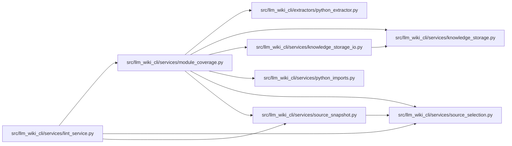

# module_coverage Module

**Path:** `src/llm_wiki_cli/services/module_coverage.py`

## Description

Static coverage explanations over selected, content-bound Python sources.

These routes are report metadata. They do not create inventory declarations,
canonical pages, durable aliases or runtime import equivalence.

## Imports

| Source | Symbols |
|--------|---------|
| `..extractors.python_extractor` | `_static_import_bindings`, `_static_type_checking_block`, `module_alias_target` |
| `.knowledge_storage` | `KnowledgeStorageError` |
| `.knowledge_storage_io` | `read_guarded` |
| `.python_imports` | `PythonModuleIndex` |
| `.source_selection` | `SourceSelectionError`, `locate_exact_repository_path` |
| `.source_snapshot` | `SourceSnapshot` |
| `__future__` | `annotations` |
| `ast` | `ast` |
| `collections.abc` | `Iterable`, `Mapping` |
| `hashlib` | `hashlib` |
| `pathlib` | `PurePosixPath` |

## Local dependency map

<!-- Auto-generated local dependency summary. Do not edit by hand. -->

### Internal neighbors

| Direction | Module |
|---|---|
| Inbound | [lint_service](../modules/lint_service.md) |
| Outbound | [python_extractor](../modules/python_extractor.md) |
| Outbound | [knowledge_storage](../modules/knowledge_storage.md) |
| Outbound | [knowledge_storage_io](../modules/knowledge_storage_io.md) |
| Outbound | [python_imports](../modules/python_imports.md) |
| Outbound | [source_selection](../modules/source_selection.md) |
| Outbound | [source_snapshot](../modules/source_snapshot.md) |

## Functions

| Function | Signature | Decorators | Description |
|----------|-----------|------------|-------------|
| `_no_implementation` | `(tree: ast.Module) -> bool` | — | — |
| `_package_binding_is_clear` | `(tree: ast.Module, child: str) -> bool` | — | Reject explicit child bindings, dynamic exports and executable setup. |
| `_alias_import` | `(tree: ast.Module, name: str) -> tuple[str, str, str]` | — | — |
| `classify_uncovered_python_sources` | `(snapshot: SourceSnapshot, inventory: Mapping, paths: Iterable[str]) -> dict[str, dict]` | — | Explain only proven omissions; all unavailable proof stays uncovered. |
