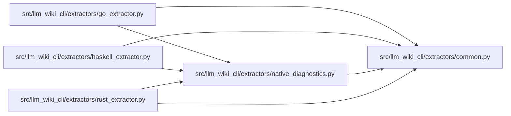

# native_diagnostics Module

**Path:** `src/llm_wiki_cli/extractors/native_diagnostics.py`

## Description

Validates `llm-wiki-native-diagnostics/v1` from the bundled Go, Rust and Haskell helpers. The envelope binds its language, selected source-relative paths, parsed inventory and per-file outcomes. Successful records require explicit extracted outcomes; failed files cannot carry inventory. Duplicate keys, unselected paths, contradictory records and invalid states invalidate the chunk. An omitted outcome stays unavailable.

Chunk orchestration preserves completed diagnostic results separately from failed and unattempted work. Ordinary helper output keeps its existing loader and failure behavior. This shared boundary prevents parser omissions from being mistaken for missing source or retirement authority. It reads neither application dependencies nor source text to guess a replacement model.

## Imports

| Source | Symbols |
|--------|---------|
| `.common` | `chunk_source_files_for_cli` |
| `__future__` | `annotations` |
| `json` | `json` |
| `sys` | `sys` |
| `typing` | `Any` |

## Local dependency map

<!-- Auto-generated local dependency summary. Do not edit by hand. -->

### Internal neighbors

| Direction | Module |
|---|---|
| Inbound | [go_extractor](../modules/go_extractor.md) |
| Inbound | [haskell_extractor](../modules/haskell_extractor.md) |
| Inbound | [rust_extractor](../modules/rust_extractor.md) |
| Outbound | [common](../modules/common.md) |

## Functions

| Function | Signature | Decorators | Description |
|----------|-----------|------------|-------------|
| `path_outcome` | `(state: str, reason: str, scope: str \| None = None) -> dict` | — | — |
| `_unique_object` | `(pairs: list[tuple[str, Any]]) -> dict` | — | — |
| `decode_diagnostics` | `(output: str, paths: list[str], language: str) -> tuple[dict, dict]` | — | Reject unselected, contradictory or unattributable helper observations. |
| `load_native_chunks` | `(extractor: Any, request: Any, source_files: list[str], helper_binary: Any, language: str) -> dict` | — | Preserve completed file scope separately from failed/aborted batches. |