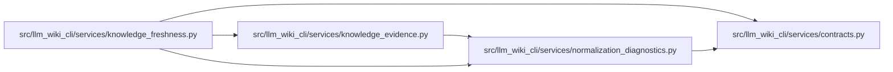

# normalization_diagnostics Module

**Path:** `src/llm_wiki_cli/services/normalization_diagnostics.py`

## Description

Formats a fresh normalization rejection as a separately versioned, bounded JSON
diagnostic. The record retains schema-field coordinates, rule and expected shape
with redacted actual type/summary; it holds no rejected inventory value. Source,
extractor and entity coordinates are bound by the basis builder and bounded only
for delivery, with explicit truncation qualifiers.

The rendered record, including its prefix, is limited to 4,096 UTF-8 bytes.
Arbitrary mapping keys and values are withheld, and an undisclosed mapping segment
keeps later failures at the last valid ancestor. Exact array indexes remain
zero-based; named entity occurrence coordinates remain one-based. No arbitrary
object repr is invoked. This diagnostic is neither a structural hash input nor
historical persisted evidence.

## Imports

| Source | Symbols |
|--------|---------|
| `.contracts` | `NORMALIZATION_DIAGNOSTIC_SCHEMA_VERSION` |
| `__future__` | `annotations` |
| `collections.abc` | `Mapping` |
| `dataclasses` | `dataclass`, `replace` |
| `json` | `json` |
| `math` | `math` |

## Local dependency map

<!-- Auto-generated local dependency summary. Do not edit by hand. -->

### Internal neighbors

| Direction | Module |
|---|---|
| Inbound | [knowledge_evidence](../modules/knowledge_evidence.md) |
| Inbound | [knowledge_freshness](../modules/knowledge_freshness.md) |
| Outbound | [services_contracts](../modules/services_contracts.md) |

## Classes

| Class | Line | Bases | Description |
|-------|------|-------|-------------|
| [NormalizationDiagnostic](../entities/NormalizationDiagnostic.md) | 41 | — | One fresh rejection; never a historical evidence promise. |

## Functions

| Function | Signature | Decorators | Description |
|----------|-----------|------------|-------------|
| `_actual` | `(value: object) -> tuple[str, str]` | — | — |