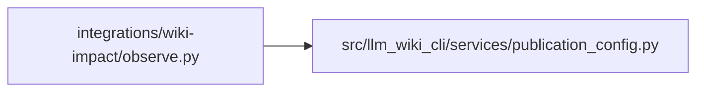

# observe Module

**Path:** `integrations/wiki-impact/observe.py`

## Description

Observe committed sibling-wiki changes against the last delivered checkpoint.

## Imports

| Source | Symbols |
|--------|---------|
| `__future__` | `annotations` |
| `importlib` | `importlib` |
| `json` | `json` |
| `llm_wiki_cli.services.publication_config` | `DELIVERY_CHECKPOINT_PATH`, `load_publication_config`, `publication_path`, `publication_ref_name`, `publication_repository` |
| `os` | `os` |
| `pathlib` | `Path` |
| `sys` | `sys` |

## Local dependency map

<!-- Auto-generated local dependency summary. Do not edit by hand. -->

### Internal neighbors

| Direction | Module |
|---|---|
| Outbound | [publication_config](../modules/publication_config.md) |

## Functions

| Function | Signature | Decorators | Description |
|----------|-----------|------------|-------------|
| `_head` | `(repo: Path) -> str` | — | — |
| `_branch` | `(repo: Path) -> str` | — | — |
| `_entry` | `(value)` | — | — |
| `observe` | `(consumer: Path, *, repository: str, config: str, target_dir: str) -> dict` | — | Read two local Git revisions; review records and Git refs are never advanced. |
| `main` | `() -> int` | — | — |
