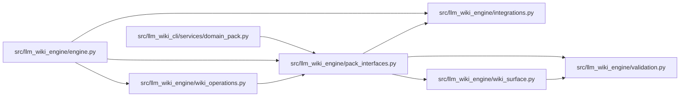

# pack_interfaces Module

**Path:** `src/llm_wiki_engine/pack_interfaces.py`

## Description

The replaceable parts of a domain pack, as the engine sees them.

A domain pack decides how sources become wiki pages: which files are sources
(:class:`SourceClassifier`), how generated pages are named
(:class:`PageNamer`) and written (:class:`PageRenderer`), how sources relate
in budgeted context (:class:`ContextSource`) and which analysis helpers a
source tree needs (:class:`HelperToolchain`). This module holds those
interfaces, the requests a renderer receives and the implementations that
need no source analysis. Applications assemble packs from them; the
code-documentation pack lives in the application that analyzes code.

``snapshot`` arguments are the application's source snapshot (see the
``source_snapshots`` integration), and prepared helpers are the application's
handles; the engine passes both through without inspecting them.

## Imports

| Source | Symbols |
|--------|---------|
| `.integrations` | `DEFAULT_INTEGRATIONS`, `IntegrationSet` |
| `.validation` | `portable_page_component`, `portable_path_key` |
| `.wiki_surface` | `PageKind` |
| `__future__` | `annotations` |
| `collections` | `Counter`, `defaultdict` |
| `collections.abc` | `Callable`, `Iterable`, `Iterator`, `Mapping` |
| `contextlib` | `contextmanager` |
| `contextvars` | `ContextVar` |
| `dataclasses` | `dataclass`, `field`, `replace` |
| `pathlib` | `PurePath` |
| `re` | `re` |
| `types` | `MappingProxyType` |
| `typing` | `Any`, `Literal`, `Protocol`, `Self`, `runtime_checkable` |

## Local dependency map

<!-- Auto-generated local dependency summary. Do not edit by hand. -->

### Internal neighbors

| Direction | Module |
|---|---|
| Inbound | [domain_pack](../modules/domain_pack.md) |
| Inbound | [engine](../modules/engine.md) |
| Inbound | [wiki_operations](../modules/wiki_operations.md) |
| Outbound | [integrations](../modules/integrations.md) |
| Outbound | [validation](../modules/validation.md) |
| Outbound | [wiki_surface](../modules/wiki_surface.md) |

## Classes

| Class | Kind | Line | Bases / Target | Description |
|-------|------|------|----------------|-------------|
| [SourceClassifier](../entities/SourceClassifier.md) | Class | 38 | `Protocol` | Decides which files are sources and of which kind. |
| [PageNamer](../entities/PageNamer.md) | Class | 62 | `Protocol` | Names the generated module and entity pages for an inventory. |
| [ModulePageRequest](../entities/ModulePageRequest.md) | Class | 79 | — | Everything a renderer gets for one module page. |
| [EntityPageRequest](../entities/EntityPageRequest.md) | Class | 97 | — | Everything a renderer gets for one entity page. |
| [PageRequest](../entities/PageRequest.md) | Class | 129 | — | Everything a renderer gets for one page that is not a module or entity. |
| [PageRenderer](../entities/PageRenderer.md) | Class | 168 | `Protocol` | Writes the Markdown of generated pages. |
| [ContextDetail](../entities/ContextDetail.md) | Type alias | 184 | `Literal['deep', 'slim', 'summary']` | — |
| [ContextSource](../entities/ContextSource.md) | Class | 188 | `Protocol` | How sources relate and appear in budgeted context. |
| [ExtensionSourceClassifier](../entities/ExtensionSourceClassifier.md) | Class | 218 | — | Classifies sources by file extension, first matching kind wins. |
| [HelperToolchain](../entities/HelperToolchain.md) | Class | 280 | — | Which analysis helpers a source tree needs, and how they are prepared. |
| [NoHelperToolchain](../entities/NoHelperToolchain.md) | Class | 306 | `HelperToolchain` | Needs and prepares no helpers. |
| [BuiltInPageRenderer](../entities/pack_interfaces_BuiltInPageRenderer.md) | Class | 327 | — | Writes each page's built-in Markdown unchanged; subclass it to adjust pages. |
| [NoContextSource](../entities/NoContextSource.md) | Class | 339 | — | Relates no sources and shows nothing of them in budgeted context. |
| [StemPageNamer](../entities/pack_interfaces_StemPageNamer.md) | Class | 461 | — | Module pages take the source file stem, entity pages the entity name. |
| [DomainPack](../entities/pack_interfaces_DomainPack.md) | Class | 551 | — | A named set of domain decisions: classification, naming, rendering, context, |

## Functions

| Function | Signature | Decorators | Description |
|----------|-----------|------------|-------------|
| `_suffixes` | `(value: object, field_name: str) -> tuple[str, ...]` | — | — |
| `_check_reference_providers` | `(providers: object) -> tuple[Any, ...]` | — | — |
| `_safe_page_component` | `(value: object, *, fallback: str = 'page') -> str` | — | — |
| `_path_parts` | `(path: str) -> tuple[str, ...]` | — | — |
| `_page_name_with_extension` | `(filepath: str) -> str` | — | A page-safe path stem that includes the source extension. |
| `_page_name_from_source_path` | `(filepath: str) -> str` | — | A page-safe stem from the full source path without extension. |
| `_disambiguate_paths` | `(filepaths: list[str], stem: str) -> dict[str, str]` | — | Add parent directories until every path sharing ``stem`` is unique. |
| `_globally_disambiguate_module_pages` | `(page_map: dict[str, str]) -> dict[str, str]` | — | Resolve portable filesystem collisions after stem-group disambiguation. |
| `_entity_occurrences` | `(inventory: Mapping[str, Mapping[str, Any]]) -> list[tuple[EntityOccurrenceKey, Mapping[str, Any]]]` | — | — |
| `_check_extractors` | `(extractors: object, classifier: SourceClassifier) -> Mapping[str, str]` | — | — |
| `_qualified_type_name` | `(value: object) -> str` | — | — |
| `active_pack` | `() -> DomainPack \| None` | — | The pack chosen for this context, or ``None`` when nobody chose one. |
| `current_pack` | `() -> DomainPack` | — | The pack chosen for this context, as the ``domain_packs`` integration reads it. |
| `using_pack` | `(pack: DomainPack) -> Iterator[DomainPack]` | `@contextmanager` | Classify, name, render and build context inside the block with ``pack``. |
