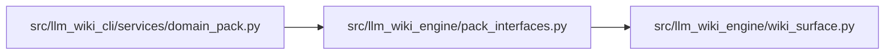

# pack_interfaces Module

**Path:** `src/llm_wiki_engine/pack_interfaces.py`

## Description

The replaceable parts of a domain pack, as the engine sees them.

A domain pack decides how sources become wiki pages: which files are sources
(:class:`SourceClassifier`), how generated pages are named
(:class:`PageNamer`) and written (:class:`PageRenderer`), how sources relate
in budgeted context (:class:`ContextSource`) and which analysis helpers a
source tree needs (:class:`HelperToolchain`). This module holds those
interfaces, the requests a renderer receives and the implementations that
need no source analysis. Applications assemble packs from them; the
code-documentation pack lives in the application that analyzes code.

``snapshot`` arguments are the application's source snapshot (see the
``source_snapshots`` integration), and prepared helpers are the application's
handles; the engine passes both through without inspecting them.

## Imports

| Source | Symbols |
|--------|---------|
| `.wiki_surface` | `PageKind` |
| `__future__` | `annotations` |
| `collections.abc` | `Callable`, `Iterable`, `Mapping` |
| `dataclasses` | `dataclass`, `field` |
| `pathlib` | `PurePath` |
| `types` | `MappingProxyType` |
| `typing` | `Any`, `Literal`, `Protocol`, `runtime_checkable` |

## Local dependency map

<!-- Auto-generated local dependency summary. Do not edit by hand. -->

### Internal neighbors

| Direction | Module |
|---|---|
| Inbound | [domain_pack](../modules/domain_pack.md) |
| Outbound | [wiki_surface](../modules/wiki_surface.md) |

## Classes

| Class | Kind | Line | Bases / Target | Description |
|-------|------|------|----------------|-------------|
| [SourceClassifier](../entities/SourceClassifier.md) | Class | 32 | `Protocol` | Decides which files are sources and of which kind. |
| [PageNamer](../entities/PageNamer.md) | Class | 56 | `Protocol` | Names the generated module and entity pages for an inventory. |
| [ModulePageRequest](../entities/ModulePageRequest.md) | Class | 73 | — | Everything a renderer gets for one module page. |
| [EntityPageRequest](../entities/EntityPageRequest.md) | Class | 91 | — | Everything a renderer gets for one entity page. |
| [PageRequest](../entities/PageRequest.md) | Class | 123 | — | Everything a renderer gets for one page that is not a module or entity. |
| [PageRenderer](../entities/PageRenderer.md) | Class | 162 | `Protocol` | Writes the Markdown of generated pages. |
| [ContextDetail](../entities/ContextDetail.md) | Type alias | 178 | `Literal['deep', 'slim', 'summary']` | — |
| [ContextSource](../entities/ContextSource.md) | Class | 182 | `Protocol` | How sources relate and appear in budgeted context. |
| [ExtensionSourceClassifier](../entities/ExtensionSourceClassifier.md) | Class | 212 | — | Classifies sources by file extension, first matching kind wins. |
| [HelperToolchain](../entities/HelperToolchain.md) | Class | 274 | — | Which analysis helpers a source tree needs, and how they are prepared. |
| [NoHelperToolchain](../entities/NoHelperToolchain.md) | Class | 300 | `HelperToolchain` | Needs and prepares no helpers. |

## Functions

| Function | Signature | Decorators | Description |
|----------|-----------|------------|-------------|
| `_suffixes` | `(value: object, field_name: str) -> tuple[str, ...]` | — | — |
